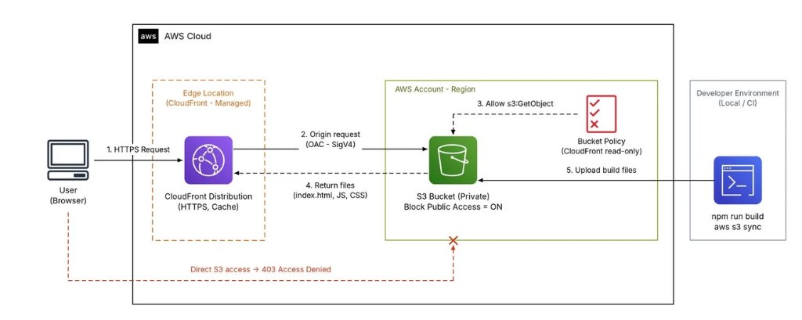

# Hosting Static Websites on Amazon S3: From Basic Deployment to CloudFront & OAC Security

> 🔗 **Published on AWS Study Group Community:** [View original Facebook post](https://www.facebook.com/groups/awsstudygroupfcj/permalink/2320770352021257/)

After completing a modern frontend application using React (or Vue, Angular), the next critical milestone is selecting an optimal deployment architecture that satisfies key engineering requirements: **minimal operational cost, high performance, robust security, and seamless scalability**.

For Single Page Applications (SPA) consisting exclusively of compiled HTML, CSS, JavaScript, and static assets, provisioning and maintaining dedicated virtual servers (such as VPS or Amazon EC2) or web servers (Nginx/Apache) incurs unnecessary maintenance overhead and financial expense. **Amazon S3 combined with Amazon CloudFront** represents the industry-standard serverless paradigm for static web hosting.

This article details two primary deployment architectures on AWS:
1. **Direct S3 Static Website Hosting** (ideal for rapid prototyping and lab learning).
2. **S3 Private Bucket with CloudFront Origin Access Control (OAC)** (the mandatory standard for production environments).

In addition, we explore key operational patterns: handling client-side SPA routing (resolving 403/404 on page refresh), granular HTTP Cache-Control header tuning, CloudFront cache invalidation strategies, and proactive cost governance.

---

## 1. Overview of Amazon S3 and Amazon CloudFront

Before implementing the deployment pipelines, it is essential to understand the architectural responsibilities of each AWS service:

* **Amazon S3 (Simple Storage Service):** A highly scalable object storage service delivering near-absolute data durability and enterprise-grade reliability. S3 serves as the persistent storage origin hosting static HTML, CSS, JavaScript bundles, images, and fonts.
* **Amazon CloudFront:** A global Content Delivery Network (CDN) service backed by hundreds of Edge Locations and regional edge caches worldwide. CloudFront terminates TLS connections, caches static content in close geographic proximity to end-users to minimize latency, supports automated payload compression, and integrates seamlessly with AWS Certificate Manager (ACM) for free custom domain SSL certificates.

When integrated: **S3 provides resilient, persistent storage**, while **CloudFront provides global edge acceleration, transport security (HTTPS), and attack mitigation**. The entire frontend operates at scale without maintaining server infrastructure.

---

## 2. Approach 1: S3 Static Website Hosting (Basic)

This approach represents the simplest method to publish a static website to the Internet within minutes, suitable for rapid testing, academic coursework, and non-production demonstrations.

### Step 1: Build the React Application
Compile the frontend source code into production-ready static assets:
```bash
# Standard build command for Vite or Create React App
npm run build
```
Depending on the bundler, static output files are generated in either `dist/` (Vite) or `build/` (Create React App). Ensure that `index.html` resides at the top level of the build directory.

### Step 2: Create S3 Bucket and Upload Static Assets
1. Open the **AWS Management Console** and navigate to **Amazon S3**.
2. Click **Create bucket**, specify a globally unique bucket name, and select the target AWS Region (e.g., `ap-southeast-1` - Singapore).
3. Once created, open the bucket, click **Upload**, and upload the entire contents of your build directory (`dist/` or `build/`). Verify that `index.html` is located directly at the root of the bucket.

### Step 3: Enable Static Website Hosting
1. Go to the bucket's **Properties** tab $\rightarrow$ scroll to **Static website hosting** $\rightarrow$ click **Edit**.
2. Select **Enable** and configure:
   * **Hosting type:** `Host a static website`.
   * **Index document:** `index.html`.
   * **Error document:** `index.html` (acts as a basic fallback for client-side routing).
3. Click **Save changes**.

### Step 4: Configure Public Read Permissions
By default, S3 activates global public access blocks. To permit public reads through the S3 Website Endpoint:
1. Navigate to the **Permissions** tab $\rightarrow$ **Block public access (bucket settings)** $\rightarrow$ click **Edit** $\rightarrow$ uncheck **Block all public access** $\rightarrow$ click **Save changes** (type `confirm`).
2. Scroll down to **Bucket policy** $\rightarrow$ click **Edit** and paste the following policy:

```json
{
  "Version": "2012-10-17",
  "Statement": [
    {
      "Sid": "PublicReadGetObject",
      "Effect": "Allow",
      "Principal": "*",
      "Action": "s3:GetObject",
      "Resource": "arn:aws:s3:::<your-bucket-name>/*"
    }
  ]
}
```
*(Replace `<your-bucket-name>` with your actual S3 bucket name).*

### Step 5: Test the Website
S3 provides a **Bucket website endpoint** formatted as:
`http://<your-bucket-name>.s3-website-<region>.amazonaws.com`
Accessing this endpoint in a browser immediately displays the live application.

---

### Limitations of Direct S3 Static Website Hosting
Despite its simplicity, this approach contains fundamental deficiencies that preclude production deployment:
* ❌ **Lack of Native HTTPS:** S3 Website Endpoints exclusively serve plaintext HTTP. Installing custom SSL/TLS certificates directly on an S3 Website Endpoint is unsupported, generating "Not Secure" browser warnings.
* ❌ **Expanded Attack Surface:** The entire bucket must be made globally public (`Principal: "*"`), violating the core AWS security tenet of Least Privilege.
* ❌ **Elevated Latency:** Traffic originates from a single AWS Region, increasing round-trip time (RTT) for geographically dispersed users.
* ❌ **Incompatibility with OAC:** S3 Website Endpoints act as custom HTTP web servers and cannot be secured using CloudFront Origin Access Control (OAC).

Consequently, direct S3 Website Hosting is strictly recommended for sandbox experimentation. Production applications should universally adopt **Approach 2**.

---

## 3. Approach 2: S3 Private Bucket + CloudFront + Origin Access Control (OAC) (Production Grade)

This architecture aligns strictly with the AWS Well-Architected Framework: **The S3 Bucket remains strictly private** with all public access blocked. Only **Amazon CloudFront** is granted read permissions via cryptographic authentication using **Origin Access Control (OAC)**.



### Key Architectural Advantages:
* 🔒 **Zero Public Exposure:** S3 **Block All Public Access** remains active. Direct requests to S3 object URLs return an immediate `403 Access Denied`.
* ⚡ **Global Edge Acceleration:** Traffic is terminated at the nearest CloudFront Edge Location, serving cached content with sub-20ms latency.
* 🛡️ **Free Managed SSL/TLS:** Enforces modern HTTPS via AWS Certificate Manager (ACM) with seamless support for custom domain names via Amazon Route 53.
* 🛡️ **DDoS Mitigation:** Native integration with AWS Shield Standard at Layer 3/4 and optional AWS WAF inspection at Layer 7.

---

### Step-by-Step Implementation:

#### Step 1: Create a Private S3 Bucket
1. Create a new Amazon S3 Bucket.
2. **Critical:** Keep **Block all public access = ON** (AWS default).
3. **Do not** add public bucket policies (`Principal: "*"`).
4. **Do not** enable S3 Static Website Hosting.
5. Upload all compiled assets from the `dist/` directory to the root of the bucket.

#### Step 2: Create CloudFront Distribution
1. In the **CloudFront Console**, select **Create distribution**.
2. **Origin Configuration:**
   * **Origin domain:** Select your S3 bucket from the dropdown list.
     > ⚠️ **Critical Note:** Choose the standard **S3 REST API endpoint** (`<bucket>.s3.<region>.amazonaws.com`). **Never** select the S3 Website Endpoint; OAC only supports REST API endpoints.
   * **Origin access:** Select **Origin access control settings (recommended)**.
   * **Origin access control:** Click **Create new OAC**, provide a descriptive name, and select Signing behavior: **Sign requests (recommended)**.
3. **Default Cache Behavior:**
   * **Viewer protocol policy:** Select **Redirect HTTP to HTTPS**.
   * **Allowed HTTP methods:** `GET, HEAD`.
   * **Cache policy:** `CachingOptimized` (AWS managed policy for maximum cache hit ratio).
   * **Compress objects automatically:** Select **Yes** (activates Gzip and Brotli compression).
4. **Settings:**
   * **Default root object:** Enter `index.html`.
5. Click **Create distribution**.

#### Step 3: Configure S3 Bucket Policy for CloudFront OAC
OAC signs every request originating from CloudFront to S3 using **AWS Signature Version 4 (SigV4)**.

Upon distribution creation, CloudFront prompts you with a policy statement. Add this statement to your S3 bucket under **Permissions $\rightarrow$ Bucket policy**:

```json
{
  "Version": "2012-10-17",
  "Statement": [
    {
      "Sid": "AllowCloudFrontServicePrincipalReadOnly",
      "Effect": "Allow",
      "Principal": {
        "Service": "cloudfront.amazonaws.com"
      },
      "Action": "s3:GetObject",
      "Resource": "arn:aws:s3:::<your-bucket-name>/*",
      "Condition": {
        "StringEquals": {
          "AWS:SourceArn": "arn:aws:cloudfront::<your-account-id>:distribution/<your-distribution-id>"
        }
      }
    }
  ]
}
```

**Key Security Constraints in the Policy:**
* `Principal`: Grants access specifically to the `cloudfront.amazonaws.com` service principal.
* `Action`: Restricts permissions strictly to read operations via `s3:GetObject`.
* `Condition` (`AWS:SourceArn`): **The cornerstone of defense.** Ensures that only your designated CloudFront Distribution ARN can read from the bucket, completely mitigating the Confused Deputy problem.

Once deployed, access the application via your CloudFront domain:
`https://dxxxxxxxxxxxxx.cloudfront.net`

Direct requests to S3 object URLs will return **Access Denied**, verifying that your storage tier is fully isolated.

---

## 4. Handling Single Page Application (SPA) Client-Side Routing

### The Root Cause
A classic obstacle when deploying React applications to static object storage involves client-side routes such as `/login`, `/dashboard`, or `/profile`:
* Internal navigations triggered via React Router link clicks succeed because routing is managed in browser memory by the JavaScript runtime.
* However, when a user refreshes the browser on `/dashboard` or pastes `https://domain.com/dashboard` directly into the address bar, the browser requests the literal object path `/dashboard` from CloudFront and S3.
* Because S3 is an object store without server-side rewriting mechanisms, it finds no matching object and responds with **403 Forbidden** or **404 Not Found**.

### Solution: CloudFront Custom Error Responses
1. Navigate to your **CloudFront Distribution** $\rightarrow$ **Error pages** tab $\rightarrow$ click **Create custom error response**.
2. **Handle HTTP 403 Forbidden:**
   * **HTTP Error Code:** `403: Forbidden`.
   * **Customize error response:** `Yes`.
   * **Response Page Path:** `/index.html`.
   * **HTTP Response Code:** `200: OK`.
3. **Handle HTTP 404 Not Found:**
   * Repeat the identical configuration for `404: Not Found` $\rightarrow$ Map to `/index.html` with HTTP Code `200: OK`.

**Execution Lifecycle:**
When S3 signals an object miss (403/404), CloudFront intercepts the error and returns `index.html` accompanied by HTTP Status 200. The browser downloads `index.html`, executes the React bundle, and React Router inspects `window.location.pathname` to render the correct view seamlessly.

---

## 5. Performance Optimization & Cost Governance Best Practices

### 5.1. Strategic Cache-Control Headers
Avoid homogenous cache durations across all static resources:
* **Hashed Bundles (`index.a8f9b2.js`, `style.7c3e1a.css`):**
  Because asset contents are immutably tied to the cryptographic file hash, configure maximum caching (1 year):
  ```http
  Cache-Control: public, max-age=31536000, immutable
  ```
* **HTML Entry Point (`index.html`):**
  The entry HTML file links to current bundle hashes and must never be permanently cached by client browsers:
  ```http
  Cache-Control: no-cache, no-store, must-revalidate
  ```
  This guarantees that subsequent deployments are immediately visible upon browser reload without stale bundle conflicts.

### 5.2. Cost-Effective Cache Invalidation
Following a deployment, CloudFront edge caches must be notified of updates:
* Avoid global wildcard invalidations (`/*`), which rapidly consume AWS's monthly tier of 1,000 free invalidation paths:
  ```bash
  # Avoid indiscriminate wildcard invalidations
  aws cloudfront create-invalidation --distribution-id <ID> --paths "/*"
  ```
* **Target strictly `index.html`:**
  ```bash
  # Best Practice: Invalidate only the entry file
  aws cloudfront create-invalidation --distribution-id <ID> --paths "/index.html"
  ```
  Because updated JS/CSS bundles feature unique hash names, updating `index.html` naturally forces browsers to fetch new assets.

### 5.3. Enable Automated Compression (Brotli & Gzip)
Ensure **Compress objects automatically = Yes** is enabled on the CloudFront Cache Behavior. CloudFront dynamically compresses eligible text payloads (HTML, CSS, JS, JSON, SVG) using Brotli or Gzip, reducing network bandwidth by 60% to 80% and accelerating page loads for mobile clients.

### 5.4. Proactive Monitoring via AWS Budgets
While S3 and CloudFront are remarkably cost-effective, configure monitoring to protect against unexpected traffic surges or crawler loops:
* Establish an **AWS Budget** with an alert threshold (e.g., $5.00/month).
* Configure automated notifications via Amazon SNS or Email when forecasted or actual spend exceeds 80% of target limits.

---

## 6. Conclusion

The architectural pairing of **Amazon S3 Private Bucket** with **Amazon CloudFront and Origin Access Control (OAC)** provides an industry-standard, production-ready foundation for modern web frontends:
* **Development & Lab Sandbox:** Use S3 Static Website Hosting for rapid proof-of-concept testing.
* **Production Environments:** Mandate S3 Private Buckets secured with CloudFront OAC for enterprise-grade isolation.
* **SPA Resilience:** Configure CloudFront Custom Error Responses mapping 403/404 errors to `/index.html`.
* **Operational Excellence:** Implement differentiated `Cache-Control` policies, targeted invalidations, and AWS Budgets alerts.

---

### Official AWS References
* [AWS Documentation - Hosting a static website using Amazon S3](https://docs.aws.amazon.com/AmazonS3/latest/userguide/WebsiteHosting.html)
* [AWS Documentation - Restricting access to an Amazon S3 origin using Origin Access Control (OAC)](https://docs.aws.amazon.com/AmazonCloudFront/latest/DeveloperGuide/private-content-restricting-access-to-s3.html)
* [AWS re:Post - Serve a static website hosted on S3 through CloudFront](https://repost.aws/knowledge-center/cloudfront-serve-static-website)
* [AWS Documentation - Request and response behavior for Amazon S3 origins](https://docs.aws.amazon.com/AmazonCloudFront/latest/DeveloperGuide/RequestAndResponseBehaviorS3Origin.html)

**Hashtags:** `#AWS` `#AmazonS3` `#CloudFront` `#OAC` `#StaticWebsite` `#ReactSPA` `#awsstudygroup` `#FCAJ`


