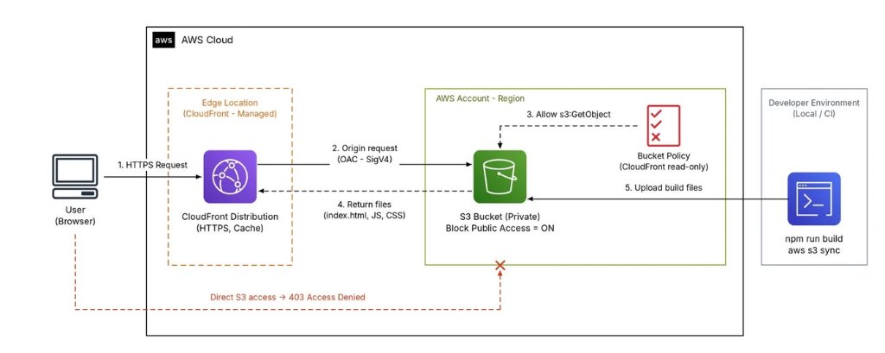

---
title: "Blog 1: Host website tĩnh trên Amazon S3 & CloudFront"
date: 2026-10-16
weight: 1
chapter: false
pre: " <b> 3.1. </b> "
---

# Host website tĩnh trên Amazon S3: Từ triển khai cơ bản đến bảo mật với CloudFront

Sau khi hoàn thành một ứng dụng frontend bằng React (hoặc Vue, Angular), bước tiếp theo là lựa chọn giải pháp triển khai (deployment) phù hợp, đáp ứng đầy đủ các tiêu chuẩn về **chi phí tối ưu, hiệu năng cao, bảo mật vững chắc và khả năng mở rộng linh hoạt**.

Đối với những ứng dụng Single Page Application (SPA) chỉ bao gồm HTML, CSS, JavaScript và các tài nguyên tĩnh sau khi build, việc thuê một máy chủ ảo (VPS/EC2) hay tự duy trì một web server (Nginx/Apache) là không thực sự cần thiết và gây lãng phí chi phí vận hành. **Amazon S3 kết hợp cùng Amazon CloudFront** chính là giải pháp serverless tối ưu hàng đầu được ưa chuộng trong ngành.

Bài viết này trình bày chi tiết hai phương án triển khai website tĩnh trên AWS:
1. **Sử dụng trực tiếp S3 Static Website Hosting** (phù hợp học tập, thử nghiệm).
2. **Sử dụng S3 Private Bucket kết hợp CloudFront Origin Access Control (OAC)** (chuẩn cho môi trường Production).

Đồng thời, bài viết hướng dẫn xử lý triệt để lỗi routing SPA (lỗi 403/404 khi người dùng refresh trang), tối ưu chiến lược Caching (Cache-Control, Invalidation) và kiểm soát chi phí thực tế.

---

## 1. Tổng quan về Amazon S3 và CloudFront

Trước khi bắt tay vào triển khai, chúng ta cần hiểu rõ vai trò và thế mạnh của hai dịch vụ cốt lõi:

* **Amazon S3 (Simple Storage Service):** Dịch vụ lưu trữ đối tượng (Object Storage) với độ bền và độ an toàn dữ liệu gần như tuyệt đối. S3 đóng vai trò là kho lưu trữ chứa toàn bộ file HTML, CSS, JavaScript, hình ảnh và tài nguyên tĩnh sau khi build.
* **Amazon CloudFront:** Dịch vụ mạng phân phối nội dung toàn cầu (CDN - Content Delivery Network) với hàng trăm Edge Locations trải khắp các châu lục. CloudFront tiếp nhận yêu cầu từ người dùng, thực hiện cache nội dung tĩnh tại vị trí địa lý gần người dùng nhất, giảm thiểu tối đa độ trễ (latency), hỗ trợ nén dữ liệu và cung cấp chứng chỉ bảo mật HTTPS miễn phí qua AWS Certificate Manager (ACM).

Khi kết hợp hai dịch vụ: **S3 đảm nhiệm việc lưu trữ dữ liệu tĩnh**, còn **CloudFront chịu trách nhiệm phân phối tốc độ cao, bảo vệ an ninh và mã hóa HTTPS**. Toàn bộ frontend sau khi build có thể vận hành ổn định mà không cần duy trì bất kỳ máy chủ backend nào.

---

## 2. Cách 1: Sử dụng S3 Static Website Hosting (Cơ bản)

Đây là phương án đơn giản, trực quan nhất để đưa một website tĩnh lên Internet trong vài phút, rất phù hợp cho mục đích học tập, thử nghiệm bài lab hoặc demo đồ án.

### Bước 1: Build ứng dụng React
Chuyển đổi mã nguồn React (JSX, TypeScript, CSS) thành các tệp tài nguyên tĩnh mà trình duyệt có thể thực thi trực tiếp:
```bash
# Lệnh build thông dụng cho Vite hoặc Create React App
npm run build
```
Tùy thuộc vào công cụ sử dụng, kết quả build sẽ được xuất ra thư mục `dist/` (Vite) hoặc `build/` (Create React App). Hãy đảm bảo file `index.html` và các thư mục `assets/` (chứa JS, CSS, hình ảnh) đã sẵn sàng để upload lên S3.

### Bước 2: Tạo S3 Bucket và upload file
1. Truy cập **AWS Management Console** $\rightarrow$ dịch vụ **Amazon S3**.
2. Chọn **Create bucket**, đặt tên bucket (tên phải là duy nhất trên toàn cầu) và chọn AWS Region phù hợp (ví dụ: `ap-southeast-1` - Singapore).
3. Sau khi bucket được tạo, chọn **Upload** và tải toàn bộ nội dung bên trong thư mục build (`dist/` hoặc `build/`) lên bucket. Đảm bảo file `index.html` nằm ngay tại cấp gốc của bucket.

### Bước 3: Bật tính năng Static Website Hosting
1. Truy cập tab **Properties** của Bucket $\rightarrow$ cuộn xuống mục **Static website hosting** $\rightarrow$ chọn **Edit**.
2. Chọn **Enable** và điền cấu hình:
   * **Hosting type:** `Host a static website`.
   * **Index document:** `index.html`.
   * **Error document:** `index.html` (cấu hình này giúp chuyển hướng các route của ứng dụng SPA về `index.html`).
3. Nhấn **Save changes**.

### Bước 4: Cấu hình mở quyền truy cập công khai
Mặc định S3 khóa toàn bộ truy cập từ bên ngoài. Để người dùng có thể đọc website qua S3 Website Endpoint, bạn cần:
1. Vào tab **Permissions** $\rightarrow$ mục **Block public access (bucket settings)** $\rightarrow$ chọn **Edit** $\rightarrow$ bỏ chọn **Block all public access** $\rightarrow$ nhấn **Save changes** (gõ `confirm` để xác nhận).
2. Cuộn xuống mục **Bucket policy** $\rightarrow$ chọn **Edit** và dán đoạn chính sách sau:

```json
{
  "Version": "2012-10-17",
  "Statement": [
    {
      "Sid": "PublicReadGetObject",
      "Effect": "Allow",
      "Principal": "*",
      "Action": "s3:GetObject",
      "Resource": "arn:aws:s3:::<your-bucket-name>/*"
    }
  ]
}
```
*(Hãy thay thế `<your-bucket-name>` bằng tên bucket thực tế của bạn).*

Policy này cho phép mọi người trên Internet có thể đọc (`s3:GetObject`) các file trong bucket.

### Bước 5: Truy cập website
Sau khi hoàn tất, S3 sẽ cung cấp cho bạn một URL tại mục Static website hosting có dạng:
`http://<your-bucket-name>.s3-website-<region>.amazonaws.com`
Bạn có thể mở URL này trên trình duyệt để kiểm tra trang web hoạt động ngay lập tức.

---

### Hạn chế của phương pháp S3 Static Website Hosting
Mặc dù rất dễ triển khai, cách này vẫn tồn tại những nhược điểm lớn khiến nó không phù hợp cho môi trường thực tế (production):
* ❌ **Không hỗ trợ HTTPS:** S3 Website Endpoint chỉ hỗ trợ giao thức HTTP thường, không thể cài SSL trực tiếp, dẫn đến cảnh báo "Không an toàn" trên trình duyệt người dùng.
* ❌ **Rủi ro bảo mật:** Buộc phải mở quyền truy cập công khai toàn bộ bucket (`Principal: "*"`), đi ngược lại nguyên tắc đặc quyền tối thiểu (Least Privilege).
* ❌ **Độ trễ cao:** Dữ liệu chỉ được phục vụ từ một Region duy nhất, người dùng ở xa sẽ chịu độ trễ lớn khi tải tài nguyên.
* ❌ **Không tương thích OAC:** S3 Website Endpoint hoạt động như một custom HTTP origin độc lập nên không thể tích hợp tính năng bảo mật Origin Access Control (OAC) của CloudFront.

Do đó, phương án này chủ yếu phù hợp để học tập. Đối với môi trường thực tế, mô hình kết hợp CloudFront và OAC dưới đây là tiêu chuẩn bắt buộc.

---

## 3. Cách 2: S3 Private Bucket kết hợp CloudFront và Origin Access Control (OAC)

Đây là giải pháp kiến trúc tối ưu và bảo mật hàng đầu được khuyến nghị bởi AWS: **Bucket S3 được giữ hoàn toàn ở chế độ Private**, khóa mọi quyền truy cập trực tiếp từ Internet, và chỉ cấp quyền đọc duy nhất cho **Amazon CloudFront** thông qua cơ chế chữ ký điện tử **Origin Access Control (OAC)**.



### Lợi ích vượt trội:
* 🔒 **Bảo mật tuyệt đối:** S3 Bucket được bật **Block All Public Access**. Mọi truy cập trực tiếp vào URL S3 đều bị chặn (`403 Access Denied`).
* ⚡ **Tốc độ vượt trội:** Nội dung được phân phối qua mạng lưới Edge Locations toàn cầu, caching thông minh giúp thời gian phản hồi dưới 20ms.
* 🛡️ **Hỗ trợ HTTPS & Tên miền riêng:** Miễn phí chứng chỉ SSL qua AWS Certificate Manager (ACM), hỗ trợ gắn Custom Domain tùy biến qua Amazon Route 53.
* 🛡️ **Bảo vệ chống tấn công:** Tự động tích hợp AWS Shield Standard chống DDoS và có thể kích hoạt AWS WAF để lọc bot, quét mã độc.

---

### Các bước triển khai chi tiết:

#### Bước 1: Tạo S3 Bucket ở chế độ Private
1. Tạo một S3 Bucket mới.
2. **Điểm mấu chốt:** Giữ nguyên trạng thái **Block all public access = ON** (mặc định của AWS).
3. **Không** thêm policy công khai `Principal: "*"`.
4. **Không** bật tính năng Static website hosting.
5. Upload toàn bộ nội dung thư mục build (`dist/`) lên bucket.
Lúc này, toàn bộ tài nguyên đã được bảo vệ hoàn toàn, không ai từ Internet có thể đọc trực tiếp từ S3.

#### Bước 2: Tạo CloudFront Distribution
1. Truy cập **AWS Console** $\rightarrow$ dịch vụ **CloudFront** $\rightarrow$ chọn **Create distribution**.
2. **Cấu hình Origin:**
   * **Origin domain:** Chọn S3 Bucket vừa tạo từ menu thả xuống.
     > ⚠️ **Lưu ý đặc biệt quan trọng:** Phải chọn **S3 REST API Endpoint** (dạng `<bucket>.s3.<region>.amazonaws.com`), **tuyệt đối không** sử dụng S3 Website Endpoint. OAC chỉ hoạt động với REST Endpoint.
   * **Origin access:** Chọn **Origin access control settings (recommended)**.
   * **Origin access control:** Nhấn **Create new OAC** $\rightarrow$ đặt tên và chọn Signing behavior: **Sign requests (recommended)**.
3. **Cấu hình Default cache behavior:**
   * **Viewer protocol policy:** Chọn **Redirect HTTP to HTTPS** (bắt buộc mọi kết nối phải qua SSL an toàn).
   * **Allowed HTTP methods:** `GET, HEAD`.
   * **Cache policy:** `CachingOptimized` (chính sách tối ưu hóa bộ nhớ đệm của AWS).
   * **Compress objects automatically:** Chọn **Yes** (tự động nén Gzip / Brotli).
4. **Cấu hình Settings:**
   * **Default root object:** Điền `index.html`.
5. Nhấn **Create distribution**.

#### Bước 3: Cấu hình Origin Access Control (OAC) và Bucket Policy
OAC là cơ chế cho phép CloudFront xác thực mọi request gửi đến S3 Origin bằng thuật toán chữ ký điện tử **AWS Signature Version 4 (SigV4)**.

Sau khi tạo Distribution, CloudFront sẽ hiển thị một banner màu xanh yêu cầu cập nhật Bucket Policy trên S3. Bạn chỉ cần sao chép policy đó và dán vào tab **Permissions $\rightarrow$ Bucket policy** của S3:

```json
{
  "Version": "2012-10-17",
  "Statement": [
    {
      "Sid": "AllowCloudFrontServicePrincipalReadOnly",
      "Effect": "Allow",
      "Principal": {
        "Service": "cloudfront.amazonaws.com"
      },
      "Action": "s3:GetObject",
      "Resource": "arn:aws:s3:::<your-bucket-name>/*",
      "Condition": {
        "StringEquals": {
          "AWS:SourceArn": "arn:aws:cloudfront::<your-account-id>:distribution/<your-distribution-id>"
        }
      }
    }
  ]
}
```

**Giải thích các thành phần chính trong Policy:**
* `Principal`: Chỉ định service principal `cloudfront.amazonaws.com` được phép thực hiện hành động.
* `Action`: Chỉ cho phép quyền đọc tệp thông qua `s3:GetObject`.
* `Resource`: Giới hạn phạm vi đọc cho các object bên trong bucket.
* `Condition` (`AWS:SourceArn`): **Điểm cốt lõi bảo mật.** Ràng buộc chỉ duy nhất CloudFront Distribution có ID cụ thể của bạn mới được đọc dữ liệu, triệt tiêu nguy cơ Confused Deputy Attack (ngăn các tài khoản AWS khác tạo CloudFront trỏ lậu vào bucket của bạn).

Sau khi cập nhật policy và CloudFront hoàn tất trạng thái triển khai, bạn có thể truy cập website qua domain của CloudFront:
`https://dxxxxxxxxxxxxx.cloudfront.net`

Nếu thử truy cập trực tiếp bằng URL của S3, bạn sẽ nhận được thông báo **Access Denied**. Đây chính là kết quả mong muốn vì S3 đã được bảo vệ hoàn toàn.

---

## 4. Xử lý triệt để Routing cho React Single Page Application (SPA)

### Bản chất của lỗi
Đây là lỗi kinh điển mà hầu như mọi kỹ sư frontend đều gặp phải khi đưa ứng dụng React lên S3 và CloudFront:
* Giả sử ứng dụng của bạn có các đường dẫn: `/login`, `/register`, `/profile`, `/dashboard`.
* Khi người dùng bắt đầu từ trang chủ và click điều hướng trong giao diện, thư viện **React Router** sẽ xử lý chuyển trang mượt mà ở phía client (Client-side routing).
* Tuy nhiên, nếu người dùng nhấn **F5 (Refresh)** hoặc truy cập trực tiếp vào `https://domain.com/profile`:
  * Trình duyệt sẽ gửi request hỏi CloudFront/S3 để tìm object `/profile`.
  * Do S3 chỉ là kho lưu trữ file vật lý tĩnh thuần túy và hoàn toàn không tồn tại tệp nào tên là `/profile`, S3 sẽ trả về mã lỗi **403 Forbidden** hoặc **404 Not Found**!

### Cách xử lý: Cấu hình CloudFront Custom Error Responses
1. Truy cập CloudFront Distribution của bạn $\rightarrow$ chuyển sang tab **Error pages** $\rightarrow$ chọn **Create custom error response**.
2. **Cấu hình xử lý cho mã lỗi 403:**
   * **HTTP Error Code:** `403: Forbidden`.
   * **Customize error response:** `Yes`.
   * **Response Page Path:** `/index.html`.
   * **HTTP Response Code:** `200: OK`.
3. **Cấu hình xử lý cho mã lỗi 404:**
   * Làm tương tự với mã lỗi `404: Not Found` $\rightarrow$ Response Page Path: `/index.html` $\rightarrow$ HTTP Response Code: `200: OK`.

**Cơ chế hoạt động:**
Khi S3 báo không tìm thấy object (403/404), CloudFront bắt được mã lỗi này và lập tức trả về nội dung tệp `index.html` với mã trạng thái thành công `200`. Trình duyệt nhận được `index.html`, nạp bundle JavaScript của React, và React Router sẽ đọc URL `/profile` hiện tại trên thanh địa chỉ để hiển thị chính xác component tương ứng!

> 💡 **Kinh nghiệm nâng cao:**
> Cách làm trên chuyển hướng mọi mã lỗi 403/404 về `index.html`. Với các hệ thống lớn, bạn có thể sử dụng **CloudFront Functions** (chạy tại viewer request) để chỉ rewrite những URL hợp lệ của ứng dụng SPA về `/index.html`, còn những request xin tài nguyên tĩnh không tồn tại (`.png`, `.js` bị thiếu) vẫn trả về 404 thực sự để dễ dàng debug.

---

## 5. Kinh nghiệm tối ưu hóa hiệu năng và kiểm soát chi phí thực tế

### 5.1. Thiết lập Cache-Control thông minh
Không nên dùng chung một chính sách cache cho tất cả các loại tài nguyên:
* **Đối với các file JS, CSS, Font có Content Hash (ví dụ: `index.a8f9b2.js`, `style.7c3e1a.css`):**
  Vì tên file sẽ tự động thay đổi mỗi khi mã nguồn được cập nhật, bạn có thể thiết lập thời gian cache tối đa (1 năm) với chỉ thị `immutable`:
  ```http
  Cache-Control: public, max-age=31536000, immutable
  ```
* **Đối với file `index.html`:**
  File này là "kim chỉ nam" dẫn đường cho trình duyệt nạp các bundle JS/CSS mới nhất. Tuyệt đối không để trình duyệt cache file này quá lâu:
  ```http
  Cache-Control: no-cache, no-store, must-revalidate
  ```
  Nhờ đó, mỗi khi deploy phiên bản mới, người dùng chỉ cần mở lại web là nhận ngay bản cập nhật mới nhất mà không bị kẹt mã nguồn cũ.

### 5.2. Sử dụng CloudFront Invalidation đúng cách
Khi deploy phiên bản mới lên S3, CloudFront tại các Edge Location vẫn có thể đang lưu phiên bản cũ trong bộ nhớ đệm:
* Thay vì chạy lệnh xóa toàn bộ cache bằng `/*` (dễ làm cạn kiệt hạn mức 1,000 invalidation paths miễn phí mỗi tháng của AWS):
  ```bash
  # Tránh dùng cho mọi lần deploy
  aws cloudfront create-invalidation --distribution-id <ID> --paths "/*"
  ```
* Bạn **chỉ cần xóa cache duy nhất file `index.html`**:
  ```bash
  # Tối ưu chi phí và hạn ngạch
  aws cloudfront create-invalidation --distribution-id <ID> --paths "/index.html"
  ```
  Khi file `index.html` được làm mới, nó sẽ tự động trỏ đến các tệp JS/CSS mới (với mã băm mới) và trình duyệt sẽ tự động tải các tài nguyên mới đó.

### 5.3. Bật nén tự động Gzip và Brotli
Trên Behavior của CloudFront, luôn đảm bảo đã chọn **Compress objects automatically = Yes**. CloudFront sẽ tự động nén các tài nguyên tĩnh dạng văn bản (HTML, CSS, JS, SVG, JSON) bằng thuật toán Brotli hoặc Gzip trước khi gửi tới trình duyệt, giúp giảm từ 60% đến 80% dung lượng truyền tải qua mạng, tăng tốc độ load trang đáng kể trên kết nối mạng yếu.

### 5.4. Giám sát chi phí với AWS Budgets
Mặc dù giải pháp S3 + CloudFront có chi phí cực kỳ thấp, bạn vẫn nên thiết lập cơ chế kiểm soát chủ động:
* Các hạng mục chi phí tiềm năng gồm: Dung lượng lưu trữ S3, số lượng request S3 (GET/PUT), lưu lượng truyền tải CloudFront (Data Transfer Out).
* Sử dụng **AWS Budgets** để đặt ngưỡng cảnh báo (ví dụ: $5 hoặc $10/tháng) và cấu hình gửi email thông báo ngay khi chi phí thực tế hoặc dự báo chạm mốc 80% ngân sách.

---

## 6. Kết luận

Amazon S3 kết hợp cùng Amazon CloudFront và OAC là một giải pháp triển khai frontend hiện đại, gọn nhẹ nhưng mang lại độ tin cậy và khả năng mở rộng ở cấp độ doanh nghiệp:
* **Học tập & Thử nghiệm:** Dùng S3 Static Website Hosting để kiểm tra nhanh ý tưởng.
* **Môi trường Production:** Bắt buộc sử dụng S3 Private Bucket kết hợp CloudFront và OAC để đảm bảo bảo mật và hiệu năng.
* **Xử lý SPA Routing:** Luôn cấu hình Custom Error Response cho mã 403/404 về `/index.html`.
* **Vận hành chuyên nghiệp:** Tách biệt chiến lược Cache-Control giữa assets và `index.html`, tối ưu lệnh Invalidation và cài đặt AWS Budgets cảnh báo chi phí.

---

### Tài liệu tham khảo chính thức
* [AWS Documentation - Hosting a static website using Amazon S3](https://docs.aws.amazon.com/AmazonS3/latest/userguide/WebsiteHosting.html)
* [AWS Documentation - Restricting access to an Amazon S3 origin using Origin Access Control (OAC)](https://docs.aws.amazon.com/AmazonCloudFront/latest/DeveloperGuide/private-content-restricting-access-to-s3.html)
* [AWS re:Post - Serve a static website hosted on S3 through CloudFront](https://repost.aws/knowledge-center/cloudfront-serve-static-website)
* [AWS Documentation - Request and response behavior for Amazon S3 origins](https://docs.aws.amazon.com/AmazonCloudFront/latest/DeveloperGuide/RequestAndResponseBehaviorS3Origin.html)

**Hashtags:** `#AWS` `#AmazonS3` `#CloudFront` `#OAC` `#StaticWebsite` `#ReactSPA` `#awsstudygroup` `#FCAJ`


