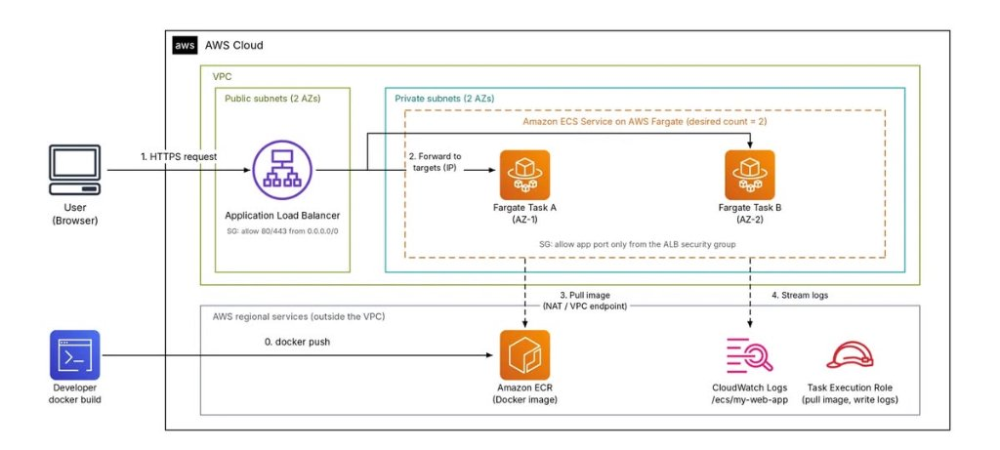

# Deploying Docker Applications on AWS with Amazon ECS and AWS Fargate

Containerization with **Docker** has established itself as the gold standard in modern software engineering. It packages application source code, system binaries, dependencies, and configuration files into an immutable image, ensuring complete consistency from a developer's local laptop to staging and production environments.

However, when deploying applications to the cloud, executing a simple `docker run` command solves only a fraction of the operational challenge. A production-ready enterprise system demands comprehensive capabilities: **automated container lifecycle management, resilient traffic distribution, granular access governance, real-time observability, and self-healing resilience**.

On Amazon Web Services (AWS), the synergy between **Amazon ECS (Elastic Container Service)** and **AWS Fargate** offers a premier serverless container solution. Rather than provisioning and maintaining virtual machine fleets (Amazon EC2), patching operating systems, or managing Docker daemons, AWS Fargate allows engineers to focus strictly on application logic and container definitions, while AWS manages the entire compute infrastructure underneath.

---

## 1. Architectural Component Overview

Operating an enterprise-grade containerized workload on AWS requires the orchestration of several integrated services:

* **Amazon ECR (Elastic Container Registry):** A fully managed, highly available private Docker container registry integrated natively with AWS IAM. Once built, container images are pushed to ECR for versioned storage and automated image vulnerability scanning.
* **Amazon ECS (Elastic Container Service):** AWS's cloud-native container orchestrator. ECS manages cluster workloads via three foundational abstractions:
  * **Task Definition:** A declarative JSON blueprint specifying container configuration: container image URI from ECR, vCPU/RAM allocations, port mappings, environment variables, storage mounts, and IAM roles.
  * **Task:** An active runtime execution instance (equivalent to a running container instance) instantiated from a Task Definition.
  * **Service:** The controller responsible for maintaining the specified number of concurrent tasks (`Desired Count`), registering tasks with the load balancer, and coordinating zero-downtime rolling deployments.
* **AWS Fargate:** A serverless compute engine purpose-built for containers. Fargate dynamically allocates compute resources matching the exact vCPU and memory profiles specified in the Task Definition without requiring EC2 server administration.
* **Application Load Balancer (ALB):** A Layer 7 load balancer that serves as the single public entry point, terminating incoming HTTPS requests and intelligently distributing traffic across healthy Fargate tasks.
* **Amazon CloudWatch:** Provides centralized telemetry collection via CloudWatch Logs (`/ecs/my-web-app`) and performance metrics via Container Insights (vCPU, memory, and network utilization).
* **AWS IAM (Identity and Access Management):** Enforces granular privilege boundaries across the architecture through two distinct roles: the Task Execution Role and the Task Role.

---

## 2. Architecture Diagram & End-to-End Workflow

The following architecture adheres strictly to the operational and security pillars of the **AWS Well-Architected Framework**:

### Step-by-Step System Lifecycle:

1. **Step 0 - Build & Publish Image (`docker push`):**
   The developer builds the container image locally or via an automated CI/CD pipeline, tags the release version, authenticates, and pushes the image to **Amazon ECR**.
2. **Step 1 - Public Ingress (`HTTPS Request`):**
   Users submit requests via web browsers over HTTPS. Traffic arrives at the **Application Load Balancer (ALB)**, which resides in **Public Subnets** distributed across two Availability Zones (AZs) for high availability.
3. **Step 2 - Routing to Private Targets (`Forward to targets`):**
   The ALB performs continuous health checks and securely routes requests directly to the private IP addresses of the running **Fargate Tasks** located in **Private Subnets**. The ECS Service maintains `Desired Count = 2`, balancing Task A in AZ-1 and Task B in AZ-2.
4. **Step 3 - Image Pull & Provisioning (`Pull Image`):**
   During task bootstrapping, Fargate invokes the **Task Execution Role** to authenticate against Amazon ECR and pull the container image through private VPC channels (via NAT Gateway or AWS PrivateLink VPC Endpoints).
5. **Step 4 - Telemetry & Log Streaming (`Stream logs`):**
   Standard output and standard error streams generated by the container are shipped in real time to the designated **CloudWatch Logs** group (`/ecs/my-web-app`) for operational auditing and debugging.

---

## 3. Critical Engineering Considerations

### 3.1. Differentiating Task Execution Role vs. Task Role
A frequent misconception among cloud engineers involves confusing the distinct security boundaries between these two IAM roles:

| Dimension | Task Execution Role | Task Role |
| :--- | :--- | :--- |
| **Identity Entity** | Granted to the **ECS Agent / Fargate Infrastructure** | Granted to the **Application Code** running inside the container |
| **Lifecycle Phase** | Invoked during task provisioning and container launch | Active throughout the runtime duration of the application |
| **Typical Permissions** | - Pulling images from Amazon ECR (`ecr:GetDownloadUrlFor...`) - Creating log streams and pushing events to CloudWatch Logs - Fetching sensitive secrets from AWS Secrets Manager or SSM Parameter Store | - Reading/writing objects in Amazon S3 buckets - Querying database items in Amazon DynamoDB - Publishing messages to Amazon SQS / Amazon SNS |

> 🔒 **Security Best Practice:** Clear separation between these two roles strictly enforces the **Principle of Least Privilege**, preventing any compromised application container from abusing infrastructure-level provisioning permissions.

---

### 3.2. `awsvpc` Networking Mode & Defense-in-Depth Security
* **Mandatory `awsvpc` Networking:** AWS Fargate mandates the `awsvpc` network mode. Each Fargate task is allocated a dedicated **Elastic Network Interface (ENI)** with a private IP address within the VPC's subnet range, granting tasks parity with native EC2 instances.
* **ALB Target Group Type:** Because tasks receive individual private IP addresses, the associated ALB Target Group must be configured with `Target type = IP` (rather than `Instance`).
* **Security Group Chaining:**
  * **ALB Security Group:** Permits inbound HTTP/HTTPS traffic (`ports 80/443`) from the public Internet (`0.0.0.0/0`).
  * **Fargate Task Security Group:** Isolated within Private Subnets without direct public routability. The inbound rule exclusively permits traffic originating from the **ALB Security Group** on the containerized application port (e.g., port 3000, 8080).
* **Private Egress Connectivity:** To allow tasks in private subnets to pull container images from ECR and stream logs to CloudWatch, subnets require egress routes via a **NAT Gateway** or, preferably, dedicated **VPC Endpoints (AWS PrivateLink)**.

---

### 3.3. Zero-Downtime Rolling Updates & Circuit Breakers
Amazon ECS natively orchestrates zero-downtime rolling updates coordinated with ALB health monitoring:
1. When a new image tag is deployed, ECS provisions new Fargate tasks alongside existing active tasks.
2. The ALB initiates health check requests (e.g., `/health`) against newly launched tasks.
3. Once new tasks transition to `healthy`, the ALB begins shifting live traffic to them.
4. The ALB applies **Deregistration Delay (Connection Draining)**, allowing in-flight requests on older tasks to complete gracefully before stopping them.
5. **Deployment Circuit Breaker:** When enabled, if new tasks repeatedly fail health checks or crash loop, ECS automatically aborts the deployment and triggers an immediate **Rollback** to the previously stable version, preventing outages.

---

## 4. Operational Monitoring & Cost Optimization

### 4.1. Live Observability & Remote Debugging with ECS Exec
* **CloudWatch Container Insights:** Delivers real-time diagnostic dashboards visualizing vCPU utilization, memory saturation, network throughput, and task counts.
* **AWS ECS Exec:** Enables developers to execute interactive shell sessions directly inside a running Fargate container **without opening SSH port 22**, managing SSH keypairs, or configuring bastion hosts. Communications are securely tunneled over AWS Systems Manager (SSM) protocols.

### 4.2. Practical Cloud Cost Management
While Fargate eliminates server maintenance overhead, compute and networking components must be managed judiciously:
* **Adopt AWS Fargate Spot:** For stateless web workers, batch processing, or non-production staging environments, Fargate Spot provides up to **70% cost savings** compared to standard On-Demand Fargate pricing.
* **VPC Endpoints vs. NAT Gateway:** NAT Gateways incur hourly availability charges in addition to per-GB data processing fees. For frequent, large image pulls, provisioning **Interface VPC Endpoints** for ECR (`ecr.api`, `ecr.dkr`) and a **Gateway VPC Endpoint** for S3 substantially eliminates recurring NAT data processing expenses.
* **Automated Budget Alerts:** Implement **AWS Budgets** to enforce monthly spending targets for the ECS cluster and receive proactive alerts via Email or SNS whenever actual or forecasted spend crosses 80%.

---

## 5. Conclusion

Deploying containerized applications on **Amazon ECS with AWS Fargate** delivers exceptional operational agility and cloud resilience:
* **Serverless Compute:** Fully abstracts host instance provisioning, AMI lifecycle maintenance, and OS security patching.
* **High Availability by Default:** Multi-AZ distribution ensures fault tolerance and automatic recovery across availability zones.
* **Layered Defense:** Decoupled public ingress (ALB) and private execution environments (Fargate) combined with strict IAM role boundaries.
* **Enterprise CI/CD Integration:** Integrates seamlessly with AWS CodePipeline or GitHub Actions, establishing an enterprise-ready foundation for scalable cloud workloads.

---

### Official AWS References
* [AWS Documentation - Amazon Elastic Container Service (ECS) Developer Guide](https://docs.aws.amazon.com/AmazonECS/latest/developerguide/Welcome.html)
* [AWS Documentation - Getting Started with Amazon ECS using AWS Fargate](https://docs.aws.amazon.com/AmazonECS/latest/developerguide/getting-started-fargate.html)
* [AWS Documentation - Amazon ECS Task Networking for Fargate](https://docs.aws.amazon.com/AmazonECS/latest/developerguide/fargate-task-networking.html)
* [AWS Prescriptive Guidance - Best practices for Amazon ECS and AWS Fargate](https://docs.aws.amazon.com/prescriptive-guidance/latest/strategy-modernizing-applications-amazon-ecs/)

**Hashtags:** `#AWS` `#AmazonECS` `#AWSFargate` `#Docker` `#AmazonECR` `#CloudComputing` `#DevOps` `#awsstudygroup` `#FCAJ`
