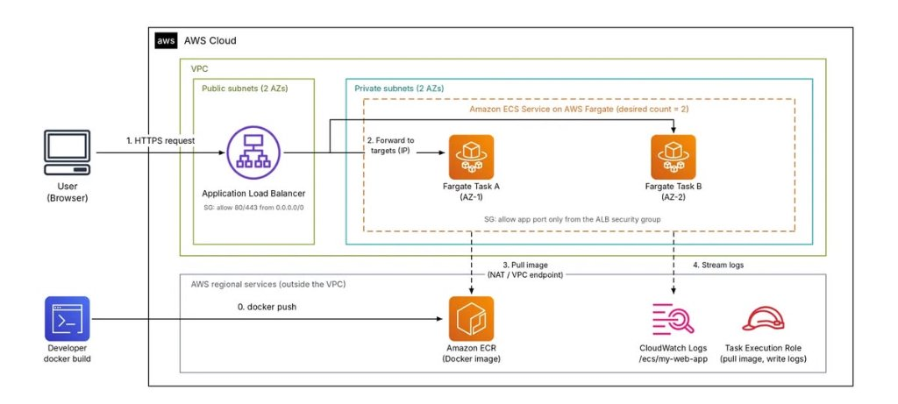

---
title: "Blog 2: Triển khai Docker trên Amazon ECS & AWS Fargate"
date: 2026-11-24
weight: 2
chapter: false
pre: " <b> 3.2. </b> "
---

# Triển khai ứng dụng Docker trên AWS với Amazon ECS và AWS Fargate

> 🔗 **Bài viết đã đăng trên cộng đồng AWS Study Group:** [Xem bài viết gốc trên Facebook](https://www.facebook.com/groups/awsstudygroupfcj/permalink/2323062025125423/)

Công nghệ container hóa với **Docker** đã trở thành tiêu chuẩn vàng trong quy trình phát triển phần mềm hiện đại, cho phép đóng gói toàn bộ mã nguồn ứng dụng cùng môi trường thực thi, thư viện phụ thuộc vào một image thống nhất, đảm bảo tính nhất quán từ môi trường cục bộ đến máy chủ thử nghiệm.

Tuy nhiên, khi đưa ứng dụng lên môi trường điện toán đám mây (Cloud), việc chạy lệnh `docker run` đơn thuần mới chỉ giải quyết được một phần rất nhỏ của bài toán. Một hệ thống sẵn sàng cho môi trường thực tế (production) đòi hỏi các năng lực toàn diện: **quản lý vòng đời container tự động, điều phối cân bằng tải lưu lượng, phân quyền truy cập an toàn, giám sát thời gian thực và tự động phục hồi khi có sự cố**.

Trên nền tảng AWS, sự kết hợp giữa **Amazon ECS (Elastic Container Service)** và **AWS Fargate** là một trong những giải pháp serverless container mạnh mẽ hàng đầu. Thay vì phải tự cấp phát máy chủ ảo EC2, vá lỗi hệ điều hành hay quản lý Docker daemon, AWS Fargate cho phép kỹ sư tập trung hoàn toàn vào việc phát triển ứng dụng và định nghĩa container, trong khi AWS đảm nhận 100% phần hạ tầng tính toán bên dưới.

---

## 1. Tổng quan các thành phần trong kiến trúc

Để vận hành một ứng dụng Docker hoàn chỉnh trên AWS, hệ thống cần có sự phối hợp nhịp nhàng giữa nhiều dịch vụ chuyên biệt:

* **Amazon ECR (Elastic Container Registry):** Kho lưu trữ container image riêng tư (Private Registry) có tính sẵn sàng cao, bảo mật và được tích hợp sâu với IAM. Docker Image sau khi được build từ máy developer hoặc pipeline CI/CD sẽ được đẩy lên ECR.
* **Amazon ECS (Elastic Container Service):** Nền tảng điều phối container (Container Orchestration) độc quyền của AWS. ECS quản lý cụm thông qua 3 khái niệm cốt lõi:
  * **Task Definition:** Bản thiết kế (blueprint) mô tả chi tiết cách container chạy: image từ ECR, mức phân bổ vCPU/RAM, cổng mạng (port), biến môi trường và quyền IAM.
  * **Task:** Một phiên bản thực thi cụ thể đang chạy (tương đương với một container instance) được sinh ra từ Task Definition.
  * **Service:** Thành phần giám sát và duy trì số lượng Task mong muốn (`Desired Count`), tự động gắn Task vào Load Balancer và thực hiện triển khai cập nhật phiên bản mới.
* **AWS Fargate:** Công nghệ tính toán Serverless dành cho container. Fargate cấp phát tài nguyên tức thì theo đúng dung lượng vCPU và Memory mà Task yêu cầu mà không cần quản trị máy chủ EC2 bên dưới.
* **Application Load Balancer (ALB):** Bộ cân bằng tải tầng ứng dụng (Layer 7), đóng vai trò là cổng đón tiếp lưu lượng HTTPS từ người dùng bên ngoài Internet và phân phối thông minh đến các Fargate Task đang khỏe mạnh.
* **Amazon CloudWatch:** Thu thập tập trung toàn bộ nhật ký ứng dụng (CloudWatch Logs) và số liệu vận hành (Container Insights) như mức sử dụng CPU, RAM, Network I/O.
* **AWS IAM (Identity and Access Management):** Kiểm soát và phân quyền chặt chẽ giữa các thành phần thông qua 2 loại role riêng biệt: Task Execution Role và Task Role.

---

## 2. Sơ đồ kiến trúc & Luồng hoạt động chi tiết

Dưới đây là mô hình kiến trúc chuẩn được thiết kế theo các nguyên tắc của **AWS Well-Architected Framework**:

### Luồng xử lý từng bước của hệ thống:

1. **Bước 0 - Đóng gói & Phát hành Image (`docker push`):**
   Developer thực hiện build mã nguồn ứng dụng thành Docker Image, gắn tag phiên bản và xác thực đẩy (push) lên kho lưu trữ **Amazon ECR**.
2. **Bước 1 - Tiếp nhận truy cập (`HTTPS Request`):**
   Người dùng truy cập ứng dụng qua trình duyệt web. Request được mã hóa bảo mật gửi đến **Application Load Balancer (ALB)** đặt tại **Public Subnets** trải rộng trên 2 Availability Zones (AZs) khác nhau để đảm bảo tính sẵn sàng cao (High Availability).
3. **Bước 2 - Phân phối lưu lượng đến các Target IP (`Forward to targets`):**
   ALB kiểm tra điều kiện sức khỏe (Health Check) và định tuyến request an toàn đến địa chỉ IP riêng của các **Fargate Task** đang chạy trong **Private Subnets**. Cụm ECS Service được thiết lập `Desired Count = 2`, phân bổ đều Task A tại AZ-1 và Task B tại AZ-2.
4. **Bước 3 - Khởi chạy và tải Image (`Pull Image`):**
   Khi Fargate Task khởi tạo, hạ tầng Fargate sử dụng **Task Execution Role** để xác thực với ECR và kéo Docker Image về qua đường truyền nội bộ (thông qua NAT Gateway hoặc VPC Endpoints kết hợp AWS PrivateLink).
5. **Bước 4 - Truyền tải nhật ký giám sát (`Stream logs`):**
   Toàn bộ luồng dữ liệu log (standard output/standard error) từ container được đẩy trực tiếp về nhóm nhật ký **CloudWatch Logs** (`/ecs/my-web-app`) theo thời gian thực để phục vụ kiểm tra và gỡ lỗi.

---

## 3. Những điểm kỹ thuật cốt lõi cần lưu ý khi triển khai

### 3.1. Phân biệt rõ ràng Task Execution Role và Task Role
Một trong những nhầm lẫn phổ biến nhất khi mới tiếp cận Amazon ECS là không phân tách rạch ròi giữa hai loại IAM Role này:

| Đặc điểm | Task Execution Role | Task Role |
| :--- | :--- | :--- |
| **Bản chất** | Cấp quyền cho chính **Hạ tầng ECS Agent / Fargate** | Cấp quyền cho **Mã nguồn ứng dụng** chạy bên trong container |
| **Thời điểm dùng** | Lúc khởi tạo và dựng container | Suốt quá trình container đang vận hành nghiệp vụ |
| **Các quyền tiêu biểu** | - Kéo Image từ Amazon ECR (`ecr:GetDownloadUrlFor...`) - Tạo log stream và gửi log lên CloudWatch (`logs:CreateLogStream`, `logs:PutLogEvents`) - Đọc biến môi trường mật từ SSM Parameter Store hoặc AWS Secrets Manager | - Đọc/ghi tệp tin vào Amazon S3 Bucket - Truy vấn bảng dữ liệu Amazon DynamoDB - Gửi bản tin vào hàng đợi Amazon SQS |

> 🔒 **Nguyên tắc bảo mật:** Phân tách rõ hai vai trò này giúp tuân thủ nghiêm ngặt nguyên tắc **Đặc quyền tối thiểu (Least Privilege)**, ngăn không cho mã độc (nếu ứng dụng bị xâm nhập) lợi dụng quyền hạ tầng của Task Execution Role.

---

### 3.2. Cấu hình mạng `awsvpc` và bảo mật nhiều lớp (Defense-in-Depth)
* **Chế độ mạng `awsvpc` là bắt buộc trên Fargate:** Mỗi Fargate Task khi khởi chạy sẽ được gắn một Card mạng ảo riêng (**Elastic Network Interface - ENI**) cùng một địa chỉ Private IP cục bộ bên trong dải IP của VPC.
* **Cấu hình Target Group của ALB:** Vì mỗi Task có IP riêng, Target Group liên kết với ALB bắt buộc phải cấu hình `Target type = IP` (thay vì `Instance` như mô hình EC2 truyền thống).
* **Kiểm soát dòng chảy Security Group (Security Group Chaining):**
  * **ALB Security Group:** Mở cổng `80/443` đón nhận traffic từ toàn bộ Internet (`0.0.0.0/0`).
  * **Fargate Task Security Group:** Đặt trong Private Subnet và **tuyệt đối không mở cổng trực tiếp ra Internet**. Cấu hình Inbound Rule chỉ cho phép duy nhất traffic từ `ALB Security Group` đi vào trên cổng của ứng dụng (ví dụ: port 3000, 8080).
* **Kết nối ra ngoài từ Private Subnet:** Để Task có thể kết nối với ECR kéo image và CloudWatch đẩy log, Private Subnet cần có đường ra Internet thông qua **NAT Gateway**, hoặc tối ưu hơn là thiết lập các **VPC Endpoints (AWS PrivateLink)** để lưu lượng đi hoàn toàn trong mạng nội bộ AWS.

---

### 3.3. Cơ chế Triển khai không gián đoạn (Zero-Downtime Deployment)
Amazon ECS tích hợp sẵn chiến lược **Rolling Update** kết hợp cùng cơ chế kiểm tra sức khỏe của ALB:
1. Khi có bản build mới, ECS khởi chạy các Fargate Task thuộc phiên bản mới song song với các Task cũ.
2. ALB tiến hành gọi liên tục vào endpoint Health Check (ví dụ: `/health`) của Task mới.
3. Chỉ khi Task mới vượt qua kiểm tra và chuyển sang trạng thái `healthy`, ALB mới bắt đầu phân bổ lưu lượng sang Task mới.
4. Sau đó, ALB thực hiện quy trình **Deregistration Delay (Connection Draining)** để hoàn tất các request đang xử lý dở dang trên Task cũ rồi mới an toàn hạ dừng Task cũ.
5. **Deployment Circuit Breaker:** Khi bật tính năng này, nếu các Task phiên bản mới liên tục bị lỗi khởi động (crash loop), ECS sẽ tự động hủy đợt deploy và kích hoạt **Rollback** quay về phiên bản ổn định gần nhất mà không làm sập hệ thống.

---

## 4. Giám sát vận hành và Chiến lược tối ưu chi phí

### 4.1. Giám sát thời gian thực & Gỡ lỗi với ECS Exec
* **Amazon CloudWatch Container Insights:** Cung cấp bảng điều khiển trực quan theo dõi mức tải vCPU, bộ nhớ RAM, lưu lượng mạng và số lượng Task theo thời gian thực.
* **AWS ECS Exec:** Cho phép kỹ sư tương tác trực tiếp bằng giao diện dòng lệnh (interactive shell / bash) vào sâu bên trong container Fargate đang chạy mà **hoàn toàn không cần mở port SSH (port 22)** hay sử dụng máy chủ trung gian Bastion Host. Tính năng này hoạt động an toàn qua giao thức mã hóa của AWS Systems Manager (SSM).

### 4.2. Tối ưu chi phí thực tế cho môi trường Cloud
Khi chuyển sang Fargate, chi phí được tính toán dựa trên mức tiêu thụ thực tế thay vì cấu hình máy chủ cố định. Tuy nhiên, cần lưu ý kiểm soát các thành phần sau:
* **Tận dụng AWS Fargate Spot:** Đối với các tác vụ xử lý nền, môi trường thử nghiệm hoặc ứng dụng phi trạng thái có khả năng chịu lỗi, sử dụng Fargate Spot giúp giảm tới **70% chi phí tính toán** so với giá Fargate tiêu chuẩn (On-Demand).
* **Tối ưu chi phí kết nối mạng (NAT Gateway vs VPC Endpoints):** NAT Gateway tính phí cố định theo giờ cộng với phí dữ liệu truyền tải. Nếu kích thước Docker Image lớn và deploy thường xuyên, việc tạo **Interface VPC Endpoints** cho ECR (`ecr.api`, `ecr.dkr`) và **Gateway VPC Endpoint** cho S3 (nơi lưu các layer của ECR) sẽ giúp tiết kiệm đáng kể chi phí băng thông NAT Gateway.
* **Cài đặt ngưỡng ngân sách tự động:** Sử dụng **AWS Budgets** để thiết lập hạn mức chi tiêu hàng tháng cho cụm ECS/Fargate và nhận cảnh báo sớm qua Email ngay khi chi phí vượt ngưỡng 80%.

---

## 5. Tổng kết

Mô hình triển khai container với **Amazon ECS và AWS Fargate** mang lại bước nhảy vọt về năng suất vận hành và độ tin cậy cho ứng dụng:
* **Loại bỏ gánh nặng hạ tầng:** Toàn bộ công việc cấu hình cụm máy chủ, cập nhật nhân Linux và quản trị Docker daemon được chuyển giao hoàn toàn cho AWS.
* **Tính sẵn sàng và độ bền cao:** Đạt chuẩn High Availability nhờ tự động phân bổ đa vùng sẵn sàng (Multi-AZ) và cơ chế tự phục hồi Task khi gặp sự cố.
* **Kiến trúc mạng chuẩn mực:** Tách biệt rõ ràng tầng Public Ingress (ALB) và Private Compute Tier (Fargate), kết hợp xác thực chữ ký IAM chặt chẽ.
* **Sẵn sàng cho DevOps:** Dễ dàng tích hợp vào các pipeline tự động hóa CI/CD với AWS CodePipeline hoặc GitHub Actions, tạo tiền đề vững chắc cho việc mở rộng quy mô trong tương lai.

---

### Tài liệu tham khảo chính thức
* [AWS Documentation - Amazon Elastic Container Service (ECS) Developer Guide](https://docs.aws.amazon.com/AmazonECS/latest/developerguide/Welcome.html)
* [AWS Documentation - Getting Started with Amazon ECS using AWS Fargate](https://docs.aws.amazon.com/AmazonECS/latest/developerguide/getting-started-fargate.html)
* [AWS Documentation - Amazon ECS Task Networking for Fargate](https://docs.aws.amazon.com/AmazonECS/latest/developerguide/fargate-task-networking.html)

**Hashtags:** `#AWS` `#AmazonECS` `#AWSFargate` `#Docker` `#AmazonECR` `#CloudComputing` `#DevOps` `#awsstudygroup` `#FCAJ`

