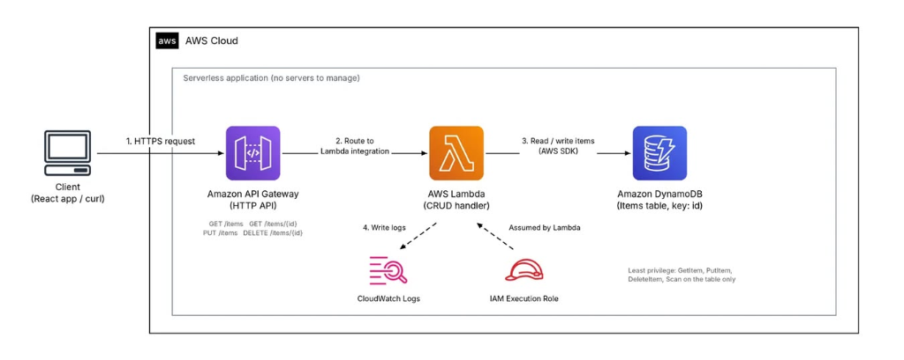

# Building a Serverless REST API with AWS Lambda, Amazon API Gateway, and Amazon DynamoDB

> 🔗 **Published on AWS Study Group Community:** [View original Facebook post](https://www.facebook.com/groups/awsstudygroupfcj/permalink/2325505481547744/)

In traditional backend architectures, web applications rely on persistent virtual servers (such as VPS or Amazon EC2) that run 24/7 to listen for and process client HTTP requests. This model imposes continuous operational burdens: operating system patch management, capacity planning, Auto Scaling configuration, and ongoing infrastructure costs even when the system experiences zero user traffic.

The advent of the **Serverless Architecture** paradigm has revolutionized cloud-native backend development. Rather than provisioning and managing server instances, software engineers can dedicate 100% of their focus to core business logic. All underlying infrastructure provisioning, high-availability multi-AZ deployment, automatic scaling during unpredictable traffic spikes, and scaling down to zero during idle periods are handled natively by the cloud provider.

The canonical serverless trio—**Amazon API Gateway + AWS Lambda + Amazon DynamoDB**—represents the industry-standard architecture for building robust, scalable CRUD (Create, Read, Update, Delete) REST APIs with minimal maintenance overhead and pay-as-you-go cost efficiency.

---

## 1. Architectural Component Overview

The system is constructed entirely using AWS fully managed, serverless services:

* **Amazon API Gateway (HTTP API):** A managed, distributed entry point that accepts inbound HTTP/HTTPS requests from clients (browsers, mobile applications, or CLI tools). API Gateway manages rate limiting, handles route parsing based on HTTP method and path, and directly integrates with backend compute engines.
* **AWS Lambda (CRUD Handler):** An event-driven serverless compute service. Lambda provisions runtime execution environments only upon receiving requests forwarded by API Gateway, dynamically scales concurrent executions to match incoming demand, and terminates immediately after execution, eliminating idle server expenses.
* **Amazon DynamoDB (Items Table):** A fully managed NoSQL key-value and document database delivering consistent, single-digit millisecond latency at any scale with automated Multi-AZ data replication.
* **AWS IAM (Execution Role):** Manages identity and provides short-lived temporary security credentials to the Lambda function. Through this execution role, Lambda accesses DynamoDB and streams logs to CloudWatch **without embedding static Access Keys or Secret Keys in the application code**.
* **Amazon CloudWatch Logs:** Centralizes the capture, indexing, and storage of runtime execution logs, invocation metrics, and unhandled exceptions for operational monitoring and debugging.

---

## 2. Architecture Diagram & Request Lifecycle

The following diagram illustrates the end-to-end request lifecycle of the Serverless REST API:



### Step-by-Step Request Execution Workflow:

1. **Step 1 - Inbound Request (`HTTPS Request`):**
   The client (React SPA, mobile client, or Postman) initiates an HTTPS request to the public Invoke URL provided by **Amazon API Gateway**.
2. **Step 2 - Intelligent Routing (`Route to Lambda integration`):**
   API Gateway analyzes the HTTP method (`GET`, `PUT`, `DELETE`) and path (`/items`, `/items/{id}`), formats the event payload (Payload Format Version 2.0), and triggers the **AWS Lambda** function via Lambda Proxy Integration.
3. **Step 3 - Business Logic & NoSQL Query (`Read/Write items via AWS SDK`):**
   The Lambda function parses the incoming `event`, extracts Path Parameters or the JSON Request Body, and uses the **AWS SDK for JavaScript v3** to perform the corresponding CRUD operation against the **Amazon DynamoDB** table (`http-crud-tutorial-items`).
4. **Step 4 - Telemetry & Log Ingestion (`Write logs`):**
   During invocation, runtime performance statistics, application `console.log` statements, and memory metrics are automatically streamed to **CloudWatch Logs**.
5. **Step 5 - Structured Response to Client:**
   Lambda compiles a standard HTTP response object (containing `statusCode: 200`, `headers: {"Content-Type": "application/json"}`, and a serialized JSON `body`) and returns it to API Gateway, which forwards the response back to the client.

---

## 3. Implementing the CRUD REST Service

### 3.1. Database Design with Amazon DynamoDB
* **Table Name:** `http-crud-tutorial-items`.
* **Partition Key:** `id` (Type: `String`) serving as the unique identifier for each item.
* **Capacity Mode:** **On-Demand (`PAY_PER_REQUEST`)**. Under On-Demand billing, you do not pre-provision Read/Write Capacity Units (RCU/WCU). DynamoDB instantly accommodates arbitrary workloads and charges strictly per read/write request, ideal for unpredictable traffic patterns.

---

### 3.2. Business Logic Implementation on AWS Lambda (Node.js)
Using the **Node.js 20.x** runtime and the modular **AWS SDK v3** (`@aws-sdk/lib-dynamodb` with `DynamoDBDocumentClient` to simplify native JavaScript object mapping):

```javascript
import { DynamoDBClient } from "@aws-sdk/client-dynamodb";
import {
  DynamoDBDocumentClient,
  ScanCommand,
  PutCommand,
  GetCommand,
  DeleteCommand,
} from "@aws-sdk/lib-dynamodb";

const client = new DynamoDBClient({});
const dynamo = DynamoDBDocumentClient.from(client);
const tableName = "http-crud-tutorial-items";

export const handler = async (event, context) => {
  let body;
  let statusCode = 200;
  const headers = {
    "Content-Type": "application/json",
  };

  try {
    const routeKey = `${event.requestContext.http.method} ${event.requestContext.http.path}`;

    switch (routeKey) {
      // 1. DELETE /items/{id} - Delete record by ID
      case `DELETE /items/${event.pathParameters?.id}`:
        await dynamo.send(
          new DeleteCommand({
            TableName: tableName,
            Key: { id: event.pathParameters.id },
          })
        );
        body = JSON.stringify({ message: `Deleted item ${event.pathParameters.id}` });
        break;

      // 2. GET /items/{id} - Retrieve record details by ID
      case `GET /items/${event.pathParameters?.id}`:
        const getRes = await dynamo.send(
          new GetCommand({
            TableName: tableName,
            Key: { id: event.pathParameters.id },
          })
        );
        body = JSON.stringify(getRes.Item || {});
        break;

      // 3. GET /items - Retrieve all records
      case "GET /items":
        const scanRes = await dynamo.send(
          new ScanCommand({ TableName: tableName })
        );
        body = JSON.stringify(scanRes.Items || []);
        break;

      // 4. PUT /items - Create or update record
      case "PUT /items":
        const requestJSON = JSON.parse(event.body);
        await dynamo.send(
          new PutCommand({
            TableName: tableName,
            Item: {
              id: requestJSON.id,
              price: requestJSON.price,
              name: requestJSON.name,
              updatedAt: new Date().toISOString(),
            },
          })
        );
        body = JSON.stringify({ message: `Put item ${requestJSON.id}` });
        break;

      default:
        throw new Error(`Unsupported route: "${routeKey}"`);
    }
  } catch (err) {
    statusCode = 400;
    body = JSON.stringify({ error: err.message });
  }

  return {
    statusCode,
    body,
    headers,
  };
};
```

#### Configuring the IAM Execution Role:
Adhering to the **Principle of Least Privilege**, restrict access strictly to the target table ARN:
```json
{
  "Version": "2012-10-17",
  "Statement": [
    {
      "Effect": "Allow",
      "Action": [
        "dynamodb:GetItem",
        "dynamodb:PutItem",
        "dynamodb:DeleteItem",
        "dynamodb:Scan"
      ],
      "Resource": "arn:aws:dynamodb:<region>:<account-id>:table/http-crud-tutorial-items"
    }
  ]
}
```

---

### 3.3. Route Mapping in Amazon API Gateway (HTTP API)
Configure four discrete routes in API Gateway and attach them to a single Lambda Proxy Integration:
* `GET /items` $\rightarrow$ Lists all items.
* `GET /items/{id}` $\rightarrow$ Fetches a single item via the `{id}` path parameter.
* `PUT /items` $\rightarrow$ Creates or updates an item from the JSON request body.
* `DELETE /items/{id}` $\rightarrow$ Removes an item matching `{id}`.

### 3.4. API Verification with cURL / Postman
Upon deployment, API Gateway yields an Invoke URL structured as: `https://<api-id>.execute-api.<region>.amazonaws.com`.
Verify each operation using standard HTTP tooling:
* **Create:** `curl -X PUT "https://<api-url>/items" -H "Content-Type: application/json" -d '{"id": "item-01", "name": "Mechanical Keyboard", "price": 120}'`
* **Read List:** `curl -X GET "https://<api-url>/items"`
* **Read Details:** `curl -X GET "https://<api-url>/items/item-01"`
* **Delete:** `curl -X DELETE "https://<api-url>/items/item-01"`

---

## 4. Architectural Analysis: HTTP API vs. REST API

Amazon API Gateway provides two primary RESTful choices. Selecting the appropriate API type aligns architectural complexity with business requirements:

| Evaluation Dimension | HTTP API (Recommended for Serverless) | REST API (Traditional Enterprise) |
| :--- | :--- | :--- |
| **Pricing** | **Ultra Cost-Effective:** \$1.00 per million requests (up to ~70% cost savings). | **Higher:** \$3.50 per million requests. |
| **Latency** | Significantly lower overhead engineered specifically for Lambda proxying. | Slightly higher due to multiple transformation middleware layers. |
| **Authentication** | Native support for OIDC and **JWT Authorizers** (Cognito, Auth0). | Supports Cognito User Pools, Lambda Authorizers, API Keys, and IAM. |
| **Quota & Throttling** | Basic Stage-level throttling. | Advanced **Usage Plans** and **API Keys** tailored for API monetization (SaaS). |
| **Advanced Features** | No native request schema validation or caching. | Comprehensive: Built-in response caching, payload transformations, AWS WAF, Private Endpoints. |

> 💡 **Architectural Recommendation:** Choose **HTTP APIs** for standard web and mobile backends requiring low latency, serverless cost optimization, and JWT security. Reserve **REST APIs** for scenarios requiring granular API Key monetization or API Gateway-level response caching.

---

## 5. Engineering Best Practices & Production Hardening

1. **Beware of DynamoDB `Scan` Operations at Scale:**
   A `Scan` sequentially parses every item across the entire physical dataset. As tables grow to millions of rows, `Scan` operations degrade latency, exhaust Read Capacity Units (RCUs), and escalate costs. Production workloads should universally favor `Query` operations executed against the **Partition Key**, **Sort Key**, or secondary indexes (**Global Secondary Indexes - GSI**).
2. **Configure Cross-Origin Resource Sharing (CORS):**
   When client web applications (React/Vue) hosted on external domains consume the API, enable CORS in API Gateway settings, permitting approved headers (`Content-Type`, `Authorization`) and HTTP methods (`GET`, `PUT`, `DELETE`, `OPTIONS`).
3. **Cold Start Optimization:**
   To minimize initial Lambda invocation latency:
   - Leverage **AWS SDK v3** and import only the required client libraries (`@aws-sdk/client-dynamodb`) rather than the monolithic SDK.
   - Initialize database clients **outside the execution `handler`** to enable TCP connection reuse across warm invocations.
4. **Resilient Input Validation & HTTP Status Discipline:**
   Wrap execution blocks in robust `try...catch` structures and return canonical REST status codes:
   - `400 Bad Request`: Missing mandatory parameters or invalid JSON.
   - `404 Not Found`: Targeted identifier does not exist.
   - `500 Internal Server Error`: Unhandled database or runtime exceptions.
5. **Infrastructure as Code (IaC):**
   For enterprise lifecycles, declare all components programmatically using **AWS SAM (Serverless Application Model)** or **AWS CDK** to enable reproducible CI/CD pipelines across environments.

---

## 6. Cost Governance & Resource Cleanup

Serverless architecture offers exceptional cost efficiency for early-stage and medium workloads through generous AWS Free Tier allocations:
* **AWS Lambda:** 1,000,000 requests per month free perpetually, plus 3.2 million seconds of compute time.
* **Amazon DynamoDB:** 25 GB of persistent storage free perpetually, accompanied by 25 write capacity units and 25 read capacity units.
* **Amazon API Gateway:** 1,000,000 API calls per month free during the initial 12-month tier.

> ⚠️ **Resource Teardown:** Upon completing laboratory testing, delete temporary DynamoDB tables, API Gateway stages, and CloudWatch log groups to ensure your account incurs zero ongoing residual charges.

---

## 7. Conclusion

The combination of **Amazon API Gateway + AWS Lambda + Amazon DynamoDB** demonstrates the core strengths of cloud-native serverless backends:
* **Zero Infrastructure Overhead:** Eliminates operating system administration, capacity provisioning, and server patch cycles.
* **Elastic Autoscaling:** Seamlessly scales from zero requests to tens of thousands of requests per second without operational intervention.
* **Pay-per-Execution Economics:** Costs scale strictly with active user invocations, delivering unprecedented financial efficiency.

---

### Official AWS References
* [AWS Documentation - Tutorial: Create a CRUD HTTP API with Lambda and DynamoDB](https://docs.aws.amazon.com/apigateway/latest/developerguide/http-api-dynamo-db.html)
* [AWS Documentation - Choosing between HTTP APIs and REST APIs](https://docs.aws.amazon.com/apigateway/latest/developerguide/http-api-vs-rest.html)
* [AWS Serverless Multi-Tier Architectures with Amazon API Gateway and AWS Lambda](https://docs.aws.amazon.com/whitepapers/latest/serverless-multi-tier-architectures-api-gateway-lambda/)

**Hashtags:** `#AWS` `#AWSLambda` `#APIGateway` `#DynamoDB` `#Serverless` `#CloudComputing` `#awsstudygroup` `#FCAJ`

