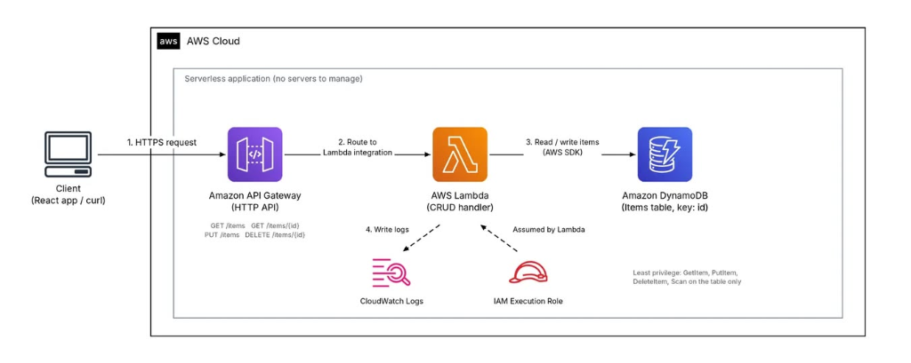

---
title: "Blog 3: Xây dựng Serverless REST API với Lambda, API Gateway & DynamoDB"
date: 2026-11-08
weight: 3
chapter: false
pre: " <b> 3.3. </b> "
---

# Xây dựng Serverless REST API với AWS Lambda, API Gateway và DynamoDB

> 🔗 **Bài viết đã đăng trên cộng đồng AWS Study Group:** [Xem bài viết gốc trên Facebook](https://www.facebook.com/groups/awsstudygroupfcj/permalink/2325505481547744/)

Trong mô hình kiến trúc backend truyền thống, ứng dụng web đòi hỏi phải có một hoặc nhiều máy chủ vật lý/máy chủ ảo (VPS, EC2) hoạt động liên tục 24/7 để tiếp nhận và xử lý request từ phía client. Điều này kéo theo gánh nặng lớn về chi phí duy trì, vá lỗi bảo mật hệ điều hành và cấu hình tự động mở rộng (Auto Scaling), ngay cả trong những khoảng thời gian hệ thống hoàn toàn không có người dùng truy cập.

Sự ra đời của **kiến trúc không máy chủ (Serverless Architecture)** đã tạo nên một cuộc cách mạng trong phát triển backend. Thay vì phải bận tâm về hạ tầng phần cứng, các kỹ sư phần mềm có thể tập trung 100% thời gian vào logic nghiệp vụ của ứng dụng. Mọi tác vụ cấp phát tài nguyên, cân bằng tải, mở rộng quy mô khi lưu lượng tăng đột biến và thu hẹp về 0 khi không có tải đều được nền tảng đám mây tự động điều phối.

Bộ ba dịch vụ kinh điển: **Amazon API Gateway + AWS Lambda + Amazon DynamoDB** chính là giải pháp serverless tiêu chuẩn công nghiệp hàng đầu để xây dựng hệ thống REST API với đầy đủ các tính năng CRUD (Create, Read, Update, Delete) với độ tin cậy cao và chi phí tối ưu nhất.

---

## 1. Tổng quan các thành phần trong kiến trúc Serverless

Hệ thống được thiết kế hoàn toàn trên các dịch vụ được AWS quản lý toàn diện (Fully Managed Services):

* **Amazon API Gateway (HTTP API):** Cổng giao tiếp phân tán an toàn đón nhận toàn bộ request HTTP/HTTPS từ client (trình duyệt, ứng dụng di động, lệnh `curl`). API Gateway đảm nhận việc kiểm soát lưu lượng (rate limiting), định tuyến request theo HTTP Method/Path và tích hợp trực tiếp với hàm xử lý backend.
* **AWS Lambda (CRUD Handler):** Dịch vụ tính toán phi máy chủ kích hoạt theo sự kiện (Event-driven Compute). Lambda chỉ khởi động và thực thi mã nguồn khi có request chuyển từ API Gateway tới, tự động nhân bản theo số lượng request đồng thời và tắt hoàn toàn khi xử lý xong, giúp tiết kiệm chi phí tối đa.
* **Amazon DynamoDB (Items Table):** Cơ sở dữ liệu NoSQL dạng Key-Value và Document được quản lý hoàn toàn, mang lại tốc độ phản hồi cực nhanh dưới 10 mili-giây (single-digit millisecond latency) ở mọi quy mô truy cập.
* **AWS IAM (Execution Role):** Quản lý định danh và cấp quyền bảo mật tạm thời cho Lambda Function. Nhờ IAM Execution Role, mã nguồn trong Lambda có thể đọc/ghi dữ liệu vào DynamoDB và đẩy log lên CloudWatch một cách an toàn mà **tuyệt đối không cần lưu trữ cứng Access Key/Secret Key trong code**.
* **Amazon CloudWatch Logs:** Trung tâm thu thập và lưu trữ toàn bộ nhật ký thực thi (Execution Logs), số liệu đo lường (Metrics) và thông báo lỗi của Lambda Function phục vụ công tác giám sát và gỡ lỗi.

---

## 2. Sơ đồ kiến trúc & Luồng xử lý dữ liệu chi tiết

Dưới đây là sơ đồ kiến trúc tổng thể của hệ thống Serverless REST API:



### Luồng xử lý một Request (Request Lifecycle):

1. **Bước 1 - Tiếp nhận truy vấn (`HTTPS Request`):**
   Client (Ứng dụng React, Web Frontend hoặc công cụ Postman) gửi HTTPS request đến Invoke URL được cung cấp bởi **Amazon API Gateway**.
2. **Bước 2 - Định tuyến thông minh (`Route to Lambda integration`):**
   API Gateway phân tích cú pháp HTTP Method (`GET`, `PUT`, `DELETE`) và URL Path (`/items`, `/items/{id}`), sau đó đóng gói ngữ cảnh sự kiện (Payload Format 2.0) và kích hoạt hàm **AWS Lambda** thông qua cơ chế Lambda Proxy Integration.
3. **Bước 3 - Xử lý nghiệp vụ & Truy vấn NoSQL (`Read/Write items via AWS SDK`):**
   Lambda Function tiếp nhận đối tượng `event`, trích xuất thông tin Path Parameters (`id`) hoặc Request Body (dữ liệu JSON), sau đó sử dụng **AWS SDK for JavaScript v3** để thực hiện thao tác tương ứng trên bảng **Amazon DynamoDB** (`http-crud-tutorial-items`).
4. **Bước 4 - Ghi nhận nhật ký giám sát (`Write logs`):**
   Trong suốt vòng đời thực thi, Lambda tự động gửi các luồng log (thời gian khởi động, log ứng dụng `console.log`, dung lượng RAM tiêu thụ) về **CloudWatch Logs**.
5. **Bước 5 - Phản hồi kết quả cho Client:**
   Lambda đóng gói dữ liệu kết quả thành một đối tượng HTTP Response chuẩn (gồm `statusCode: 200`, `headers: {"Content-Type": "application/json"}`, và `body`), gửi ngược lại API Gateway để chuyển tiếp về cho người dùng.

---

## 3. Xây dựng dịch vụ REST API theo mô hình CRUD

Để xây dựng một API quản lý dữ liệu hoàn chỉnh, chúng ta triển khai 4 hành vi cốt lõi:

### 3.1. Thiết kế cơ sở dữ liệu với Amazon DynamoDB
* **Tên bảng:** `http-crud-tutorial-items`.
* **Khóa chính (Partition Key):** `id` (Kiểu dữ liệu `String`) dùng để định danh duy nhất cho từng bản ghi.
* **Chế độ tính cước (Capacity Mode):** Khuyến nghị chọn **On-Demand (`PAY_PER_REQUEST`)**. Với chế độ này, bạn không cần phải ước lượng trước thông lượng đọc/ghi (RCU/WCU). DynamoDB sẽ tự động co giãn theo tải thực tế và chỉ tính tiền khi có request phát sinh, rất phù hợp cho giai đoạn phát triển và hệ thống có lượng truy cập biến động.

---

### 3.2. Viết mã nguồn xử lý nghiệp vụ trên AWS Lambda (Node.js)
Sử dụng runtime **Node.js 20.x** kết hợp cùng thư viện hiện đại **AWS SDK v3** (`@aws-sdk/lib-dynamodb` với `DynamoDBDocumentClient` giúp tự động chuyển đổi dữ liệu JavaScript sang định dạng DynamoDB):

```javascript
import { DynamoDBClient } from "@aws-sdk/client-dynamodb";
import {
  DynamoDBDocumentClient,
  ScanCommand,
  PutCommand,
  GetCommand,
  DeleteCommand,
} from "@aws-sdk/lib-dynamodb";

const client = new DynamoDBClient({});
const dynamo = DynamoDBDocumentClient.from(client);
const tableName = "http-crud-tutorial-items";

export const handler = async (event, context) => {
  let body;
  let statusCode = 200;
  const headers = {
    "Content-Type": "application/json",
  };

  try {
    const routeKey = `${event.requestContext.http.method} ${event.requestContext.http.path}`;

    switch (routeKey) {
      // 1. DELETE /items/{id} - Xóa một bản ghi theo ID
      case `DELETE /items/${event.pathParameters?.id}`:
        await dynamo.send(
          new DeleteCommand({
            TableName: tableName,
            Key: { id: event.pathParameters.id },
          })
        );
        body = JSON.stringify({ message: `Deleted item ${event.pathParameters.id}` });
        break;

      // 2. GET /items/{id} - Lấy chi tiết một bản ghi theo ID
      case `GET /items/${event.pathParameters?.id}`:
        const getRes = await dynamo.send(
          new GetCommand({
            TableName: tableName,
            Key: { id: event.pathParameters.id },
          })
        );
        body = JSON.stringify(getRes.Item || {});
        break;

      // 3. GET /items - Lấy toàn bộ danh sách bản ghi
      case "GET /items":
        const scanRes = await dynamo.send(
          new ScanCommand({ TableName: tableName })
        );
        body = JSON.stringify(scanRes.Items || []);
        break;

      // 4. PUT /items - Tạo mới hoặc Cập nhật bản ghi
      case "PUT /items":
        const requestJSON = JSON.parse(event.body);
        await dynamo.send(
          new PutCommand({
            TableName: tableName,
            Item: {
              id: requestJSON.id,
              price: requestJSON.price,
              name: requestJSON.name,
              updatedAt: new Date().toISOString(),
            },
          })
        );
        body = JSON.stringify({ message: `Put item ${requestJSON.id}` });
        break;

      default:
        throw new Error(`Unsupported route: "${routeKey}"`);
    }
  } catch (err) {
    statusCode = 400;
    body = JSON.stringify({ error: err.message });
  }

  return {
    statusCode,
    body,
    headers,
  };
};
```

#### Cấu hình IAM Execution Role cho Lambda:
Theo nguyên tắc **Đặc quyền tối thiểu (Least Privilege)**, chỉ gán các quyền thực sự cần thiết trên đúng ARN của bảng:
```json
{
  "Version": "2012-10-17",
  "Statement": [
    {
      "Effect": "Allow",
      "Action": [
        "dynamodb:GetItem",
        "dynamodb:PutItem",
        "dynamodb:DeleteItem",
        "dynamodb:Scan"
      ],
      "Resource": "arn:aws:dynamodb:<region>:<account-id>:table/http-crud-tutorial-items"
    }
  ]
}
```

---

### 3.3. Định tuyến trên Amazon API Gateway (HTTP API)
Cấu hình 4 Routes trong API Gateway và trỏ tất cả về Lambda Function thông qua một Integration duy nhất:
* `GET /items` $\rightarrow$ Lấy danh sách sản phẩm.
* `GET /items/{id}` $\rightarrow$ Xem chi tiết sản phẩm qua tham số đường dẫn `{id}`.
* `PUT /items` $\rightarrow$ Thêm mới hoặc cập nhật thông tin sản phẩm từ Request Body.
* `DELETE /items/{id}` $\rightarrow$ Xóa sản phẩm theo `{id}`.

### 3.4. Kiểm thử API với Postman / cURL
Sau khi deploy, API Gateway cấp một Invoke URL dạng: `https://<api-id>.execute-api.<region>.amazonaws.com`.
Bạn có thể dễ dàng kiểm thử các chức năng:
* **Thêm mới:** `curl -X PUT "https://<api-url>/items" -H "Content-Type: application/json" -d '{"id": "item-01", "name": "Mechanical Keyboard", "price": 120}'`
* **Lấy danh sách:** `curl -X GET "https://<api-url>/items"`
* **Lấy chi tiết:** `curl -X GET "https://<api-url>/items/item-01"`
* **Xóa bản ghi:** `curl -X DELETE "https://<api-url>/items/item-01"`

---

## 4. Phân tích chuyên sâu: Nên chọn HTTP API hay REST API?

Amazon API Gateway cung cấp 2 loại RESTful API chính. Việc lựa chọn đúng loại giúp hệ thống tối ưu cả về chi phí lẫn hiệu năng:

| Tiêu chí so sánh | HTTP API (Khuyến nghị cho Serverless) | REST API (Truyền thống / Doanh nghiệp) |
| :--- | :--- | :--- |
| **Chi phí** | **Rất rẻ:** Chỉ \$1.00 cho 1 triệu request đầu tiên (rẻ hơn ~70%). | **Cao hơn:** Khoảng \$3.50 cho 1 triệu request. |
| **Độ trễ (Latency)** | Rất thấp, tối ưu hóa đường truyền cho Lambda. | Cao hơn một chút do xử lý qua nhiều lớp middleware. |
| **Xác thực bảo mật** | Tích hợp sẵn OIDC và **JWT Authorizer** (Cognito, Auth0, Firebase). | Hỗ trợ Cognito User Pools, Lambda Authorizers, API Keys, AWS IAM. |
| **Quản lý hạn ngạch** | Giới hạn throttling cơ bản ở tầng Stage. | Hỗ trợ **Usage Plans** và **API Keys** chi tiết cho từng khách hàng (SaaS). |
| **Tính năng nâng cao** | Không hỗ trợ Request Validation, WAF (hiện đã hỗ trợ hạn chế), Cache. | Hỗ trợ đầy đủ: Cache tích hợp, Request/Response Transformation, AWS WAF, Private Endpoints. |

> 💡 **Khuyến nghị kiến trúc:** Nếu bạn xây dựng backend cho ứng dụng Web/Mobile thông thường cần tốc độ phản hồi nhanh, chi phí thấp và xác thực JWT, hãy ưu tiên **HTTP API**. Chỉ sử dụng **REST API** khi bạn cần tính năng thương mại hóa API (bán gói cước API Keys, Usage Plans) hoặc yêu cầu bộ đệm cache chuyên sâu tại API Gateway.

---

## 5. Những kinh nghiệm thực chiến & Best Practices khi triển khai

1. **Cảnh giác với thao tác `Scan` trong DynamoDB:**
   Thao tác `Scan` sẽ duyệt qua toàn bộ bảng dữ liệu để lọc kết quả. Khi dữ liệu phình to lên hàng triệu dòng, `Scan` sẽ gây chậm chạp nghiêm trọng, đốt cháy hạn mức đọc (RCU) và phát sinh chi phí lớn. Trong thực tế, luôn ưu tiên sử dụng `Query` dựa trên **Partition Key**, **Sort Key** hoặc tạo thêm **Global Secondary Indexes (GSI)** để truy vấn chính xác.
2. **Kích hoạt CORS (Cross-Origin Resource Sharing):**
   Khi xây dựng frontend (React/Vue) chạy trên domain khác gọi đến API Gateway, bạn phải kích hoạt CORS trong cài đặt của API Gateway, cho phép các Headers (`Content-Type`, `Authorization`) và Methods (`GET`, `PUT`, `DELETE`, `OPTIONS`) hợp lệ.
3. **Giảm thiểu độ trễ khởi động nguội (Cold Start):**
   Để Lambda phản hồi nhanh nhất:
   - Sử dụng **AWS SDK v3** và chỉ `import` đúng các sub-modules cần thiết (`@aws-sdk/client-dynamodb`) thay vì toàn bộ SDK khổng lồ.
   - Khởi tạo kết nối DynamoDB client **bên ngoài hàm `handler`** để tái sử dụng kết nối (Connection Reuse) qua các lần gọi tiếp theo.
4. **Kiểm tra dữ liệu đầu vào & Chuẩn hóa mã lỗi HTTP:**
   Luôn bọc logic xử lý trong khối `try...catch` và trả về mã lỗi chuẩn RESTful:
   - `400 Bad Request`: Thiếu trường dữ liệu bắt buộc hoặc JSON không hợp lệ.
   - `404 Not Found`: Khi tìm kiếm một `id` không tồn tại.
   - `500 Internal Server Error`: Lỗi hạ tầng hoặc lỗi kết nối cơ sở dữ liệu.
5. **Tự động hóa với Infrastructure as Code (IaC):**
   Khi dự án phát triển lớn hơn, hãy chuyển sang định nghĩa hạ tầng bằng mã nguồn thông qua **AWS SAM (Serverless Application Model)** hoặc **AWS CDK** để dễ dàng nhân bản môi trường Dev, Staging và Production.

---

## 6. Quản lý chi phí & Dọn dẹp tài nguyên

Kiến trúc Serverless cực kỳ tiết kiệm cho các dự án vừa và nhỏ nhờ chính sách AWS Free Tier hào phóng:
* **AWS Lambda:** 1,000,000 requests miễn phí mỗi tháng vĩnh viễn và 3,200,000 giây tính toán miễn phí.
* **Amazon DynamoDB:** 25 GB dung lượng lưu trữ miễn phí vĩnh viễn, kèm 25 đơn vị WCU và 25 RCU.
* **Amazon API Gateway:** 1,000,000 API calls miễn phí mỗi tháng trong 12 tháng đầu tiên.

> ⚠️ **Lưu ý dọn dẹp sau bài thực hành:** Sau khi hoàn thành bài lab thử nghiệm, hãy chủ động xóa bảng DynamoDB, API Gateway và các log stream trong CloudWatch Logs để giữ cho tài khoản AWS luôn gọn gàng và không phát sinh chi phí ngầm.

---

## 7. Tổng kết

Mô hình kết hợp **API Gateway + AWS Lambda + DynamoDB** là biểu tượng mẫu mực của kiến trúc Cloud-Native hiện đại:
* **Không máy chủ (Zero Server):** Không cần duy trì, nâng cấp hay vá lỗi máy chủ.
* **Tự động mở rộng (Infinite Scale):** Tự động xử lý từ vài request đến hàng chục nghìn request mỗi giây mà không cần can thiệp thủ công.
* **Chi phí theo mức dùng thực tế (Pay-as-you-go):** Tiết kiệm tối đa chi phí vận hành cho các startup và doanh nghiệp.

---

### Tài liệu tham khảo chính thức
* [AWS Documentation - Tutorial: Create a CRUD HTTP API with Lambda and DynamoDB](https://docs.aws.amazon.com/apigateway/latest/developerguide/http-api-dynamo-db.html)
* [AWS Documentation - Choosing between HTTP APIs and REST APIs](https://docs.aws.amazon.com/apigateway/latest/developerguide/http-api-vs-rest.html)
* [AWS Serverless Multi-Tier Architectures with Amazon API Gateway and AWS Lambda](https://docs.aws.amazon.com/whitepapers/latest/serverless-multi-tier-architectures-api-gateway-lambda/)

**Hashtags:** `#AWS` `#AWSLambda` `#APIGateway` `#DynamoDB` `#Serverless` `#CloudComputing` `#awsstudygroup` `#FCAJ`

