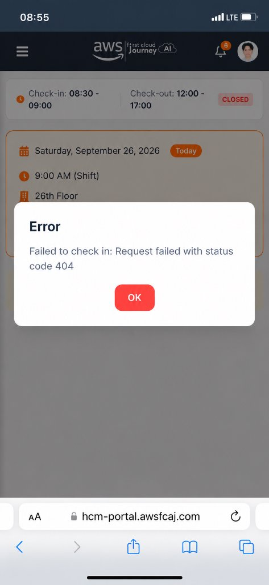
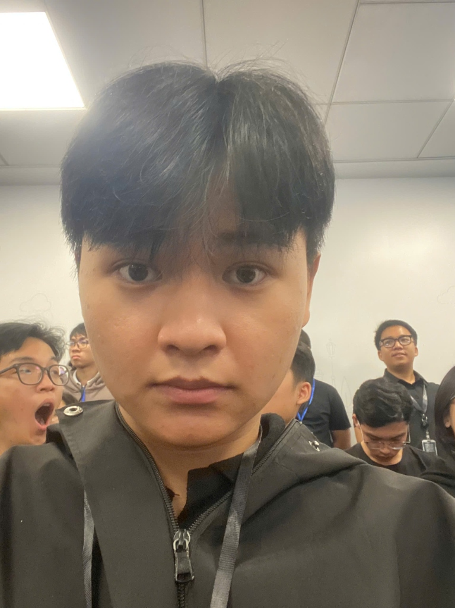

# Event Attendance Report: Kickoff FCAJ Buildrathon 2026 (Season 01)

### Event Executive Summary:
* **Event Name:** KICKOFF FCAJ BUILDRATHON 2026 (SEASON 01): 300+ BUILDERS AT AWS OFFICE!
* **Core Theme / Talkshow:** "The Thinking Behind Building The Bot" (In partnership with CMC Global)
* **Date & Time:** 08:30 - 12:00, Saturday, September 26, 2026
* **Location:** AWS Vietnam Office, 26th Floor, Bitexco Financial Tower, No. 02 Hai Trieu, Ben Nghe Ward, District 1, Ho Chi Minh City
* **Organizers:** AWS Study Group in collaboration with CMC Global
* **Scale & Attendance:** Over 300 cloud practitioners, builders, mentors, and IT students
* **Participant Role:** Attendee / Builder

---

## 1. Objectives & Significance of the Event

The Kickoff Event marked the official launch of the **FCAJ Buildrathon 2026 Season 01**—an intensive 6-month hands-on competitive arena designed to foster innovation, cloud-native engineering, and practical AI implementations across Vietnam's tech community.

The core objectives of the event included:
1. **Initiating the 6-Month Buildrathon:** Introducing program rules, challenge milestones, and evaluation criteria for builder teams.
2. **Enterprise AI Agent Engineering:** Sharing modern architectural blueprints and methodology for building reliable AI Bots and Autonomous Agents in enterprise environments.
3. **Deconstructing Technical Challenges:** Analyzing complex real-world test cases with senior cloud solution architects.
4. **Fast-Track Career Networking:** Providing direct 1-on-1 career counseling and recruitment networking with CMC Global's talent acquisition team.
5. **Community Spirit:** Upholding the core "Pay It Forward" ethos shared across the AWS Study Group community.

---

## 2. Key Sessions & Technical Highlights

Hosted at the AWS Vietnam Office, the event featured highly engaging and technical deep-dives:

### 2.1. Panel Talkshow: "The Thinking Behind Building The Bot"
Collaborative technical discussions featuring domain experts from AWS Study Group and CMC Global delivered valuable engineering perspectives:
* **Pragmatic AI Agent Design:** Differentiating basic conversational chatbots from autonomous, multi-step AI Agents capable of reasoning, planning, memory management, and function/tool calling.
* **Architectural Foundations:** Best practices in building scalable agent backends integrating Large Language Models (LLMs), Retrieval-Augmented Generation (RAG) pipelines, and AWS cloud services.
* **Enterprise Optimization:** Balancing latency, response accuracy, hallucinations, and token cost economics when serving high-concurrency enterprise workloads.

### 2.2. Technical Challenge Breakdown
* Solution architects deconstructed sample competition challenges, demonstrating effective problem formulation and edge-case handling.
* Guidance on collaborative problem-solving, rapid prototyping, and hands-on experimentation with cutting-edge cloud and generative AI tools.

### 2.3. Fast-Track Career & Industry Networking
* Direct engagement opportunities with senior engineers and talent acquisition specialists from CMC Global.
* Insights into current market demands, hiring expectations, and required competencies for Cloud Engineers and AI Specialists.

---

## 3. Key Takeaways & Professional Development

Attending the Kickoff Event provided immense practical value for my ongoing internship and engineering journey:

### 3.1. Architectural & Engineering Insights
* **Product-Driven Engineering:** Technology is an enabler; designing effective AI Agents requires first deeply understanding domain problems and user friction points.
* **Resilient System Design:** Gained structured methodologies for agent orchestration, conversational context lifecycle management, and secure cloud API integration.

### 3.2. Professional Growth & Soft Skills
* **Professional Networking:** Connected and exchanged experiences with over 300 passionate builders across the AWS community.
* **Career Clarity:** Practical career guidance from CMC Global HR leaders helped clarify key technical proficiencies to hone throughout my 12-week internship.
* **Community Inspiration:** The "Pay It Forward" energy of mentors and organizers served as a profound motivation to continuously learn and share knowledge.

---

## 4. Attendance Verification & Check-in Incident Report

### 4.1. Portal Check-in Incident Report
* **Designated Schedule:** Morning Shift (9:00 AM Shift), official check-in window between **08:30 - 09:00**, on **September 26, 2026** at Bitexco 26th Floor.
* **System Incident:** Upon arriving on-site at the AWS Vietnam Office and attempting to check in via the student portal (`hcm-portal.awsfcaj.com`), the web application encountered a server error returning an HTTP 404 status:
  > *"Failed to check in: Request failed with status code 404"*
* The screenshot below documents the live error modal encountered on the portal during the check-in window:

---

### 4.2. Photographic Proof of Physical Attendance
To establish verified physical attendance at the event, the following photograph captures myself (Nguyen Trung Hau) on-site inside the AWS Vietnam Office seminar room (26th Floor, Bitexco Financial Tower), wearing the official event participant lanyard alongside fellow attendees:

