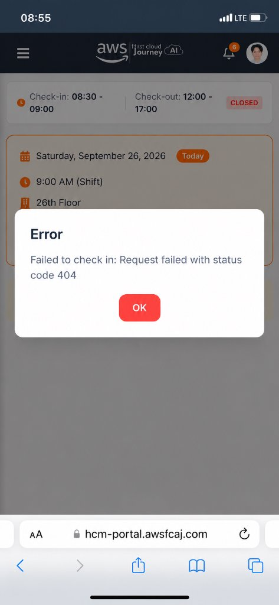
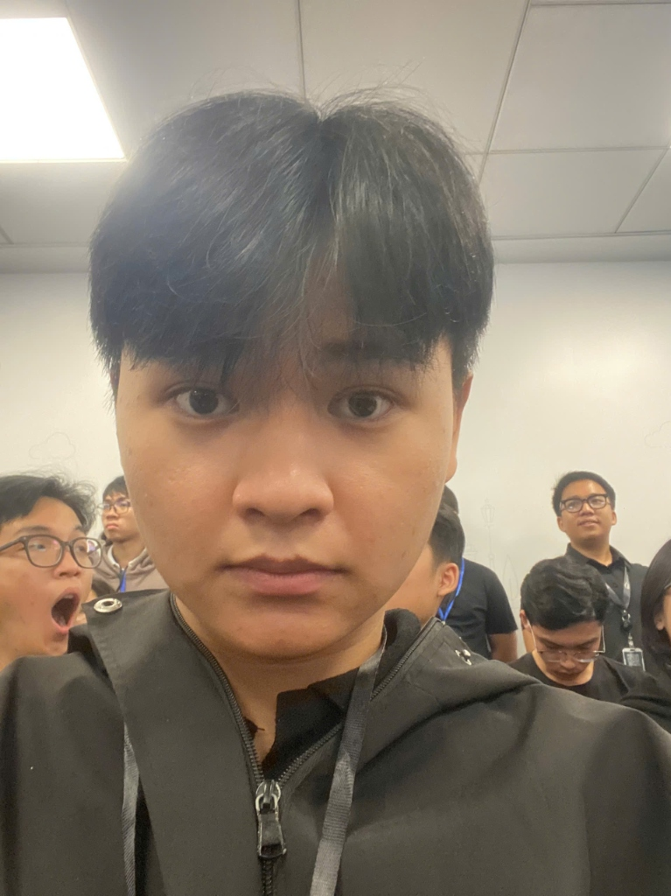

# Báo cáo tham gia sự kiện: Kickoff FCAJ Buildrathon 2026 (Season 01)

### Thông tin tổng quan sự kiện:
* **Tên sự kiện:** KICKOFF FCAJ BUILDRATHON 2026 (SEASON 01): 300+ BUILDERS "BÙNG NỔ" TẠI VĂN PHÒNG AWS!
* **Chủ đề chính (Talkshow):** "The Thinking Behind Building The Bot" (Đồng hành cùng CMC Global)
* **Thời gian tổ chức:** 08:30 - 12:00, Thứ Bảy, ngày 26/09/2026
* **Địa điểm:** Văn phòng AWS Việt Nam, Tầng 26, Tòa nhà Bitexco Financial Tower, Số 02 Hải Triều, Bến Nghé, Quận 1, TP. Hồ Chí Minh
* **Đơn vị tổ chức:** AWS Study Group phối hợp cùng CMC Global
* **Quy mô sự kiện:** Hơn 300 thành viên, kỹ sư, sinh viên và builders đam mê công nghệ Cloud & AI
* **Vai trò tham dự:** Người tham dự (Participant / Builder)

---

## 1. Mục đích và Ý nghĩa của sự kiện

Sự kiện Kickoff là phát súng mở màn chính thức cho hành trình **FCAJ Buildrathon 2026 Season 01** – một sân chơi thực chiến kéo dài 6 tháng đầy thử thách và đột phá dành riêng cho cộng đồng AI & Cloud tại Việt Nam.

Mục tiêu chính của buổi Kickoff bao gồm:
1. **Khởi động sân chơi công nghệ:** Giới thiệu thể lệ, lộ trình thử thách 6 tháng và truyền cảm hứng đổi mới sáng tạo cho các đội thi.
2. **Tiếp cận tư duy AI Agent thực chiến:** Chia sẻ phương pháp luận đặt nền móng kiến trúc cho một hệ thống AI Bot/Agent hoàn chỉnh trong môi trường doanh nghiệp.
3. **Mổ xẻ các thử thách kỹ thuật:** Trực tiếp phân tích các bài toán thực tế hóc búa cùng các chuyên gia giải pháp hàng đầu.
4. **Kết nối nghề nghiệp (Fast-track career):** Mở ra cơ hội giao lưu, kết nối 1-1 trực tiếp cùng đội ngũ chuyên gia nhân sự (HR) của CMC Global.
5. **Lan tỏa văn hóa cộng đồng:** Tiếp nối và phát huy tinh thần **"Pay It Forward"** rực lửa của đại gia đình AWS Study Group.

---

## 2. Nội dung nổi bật tại sự kiện

Sự kiện diễn ra với không khí vô cùng sôi động và nhiệt huyết tại Văn phòng AWS Việt Nam với các phiên thảo luận chuyên sâu:

### 2.1. Talkshow "The Thinking Behind Building The Bot"
Buổi tọa đàm với sự góp mặt của các chuyên gia công nghệ từ AWS Study Group và CMC Global đã mang lại nhiều góc nhìn sâu sắc:
* **Tư duy thiết kế AI Agent thực tế:** Làm rõ sự khác biệt giữa một Chatbot đơn thuần và một AI Agent tự hành có khả năng suy luận, lập kế hoạch và gọi công cụ (Tool calling / Function calling).
* **Kiến trúc nền tảng:** Hướng dẫn cách xây dựng kiến trúc mở rộng cho Bot, kết hợp giữa mô hình ngôn ngữ lớn (LLM), kỹ thuật Retrieval-Augmented Generation (RAG) và cơ sở hạ tầng đám mây AWS.
* **Tối ưu hóa bài toán doanh nghiệp:** Phân tích các tiêu chí cân bằng giữa độ chính xác, độ trễ phản hồi (latency) và chi phí vận hành (token cost) khi triển khai cho khách hàng doanh nghiệp quy mô lớn.

### 2.2. Giải mã thử thách kỹ thuật (Challenge Breakdown)
* Các chuyên gia đã trực tiếp "mổ xẻ" các bài test kỹ thuật mẫu của cuộc thi Buildrathon.
* Hướng dẫn cách phân tích yêu cầu nghiệp vụ, xác định các trường hợp biên (edge cases) và cách tiếp cận "học thật, va chạm thật" với các công nghệ đám mây tiên tiến.

### 2.3. Fast-track Career – Kết nối cùng CMC Global
* Cơ hội trao đổi trực tiếp với dàn HR và kỹ sư cấp cao của CMC Global ngay tại sự kiện.
* Nắm bắt nhu cầu tuyển dụng thực tế đối với các vị trí Cloud Engineer, AI Engineer và những kỹ năng cốt lõi mà doanh nghiệp công nghệ hàng đầu tìm kiếm ở các ứng viên trẻ.

---

## 3. Kiến thức và Giá trị thu nhận được

Tham gia buổi Kickoff tại Văn phòng AWS đã mang lại cho tôi nhiều giá trị và trải nghiệm thực tế quý báu:

### 3.1. Về tư duy công nghệ & Kiến trúc hệ thống
* **Tư duy hướng sản phẩm (Product Mindset):** Khi xây dựng Bot/AI Agent, công nghệ chỉ là công cụ hỗ trợ; điều quan trọng nhất là giải quyết đúng nỗi đau (pain point) của người dùng và mang lại giá trị thực tế.
* **Nền tảng kiến trúc vững chắc:** Nắm được quy trình thiết kế bot chuẩn chỉnh từ khâu định hình hành vi, quản lý ngữ cảnh hội thoại, đến tích hợp an toàn với các dịch vụ dữ liệu trên Cloud.

### 3.2. Về kỹ năng mềm và Định hướng nghề nghiệp
* **Mở rộng mối quan hệ (Networking):** Được giao lưu, học hỏi kinh nghiệm cùng hơn 300 builders tài năng trong cộng đồng AWS Study Group.
* **Hiểu rõ yêu cầu thị trường:** Nhận được những lời khuyên định hướng nghề nghiệp thiết thực từ các anh chị HR CMC Global, giúp tôi xác định rõ hơn lộ trình rèn luyện chuyên môn trong giai đoạn thực tập.
* **Tiếp thêm động lực học tập:** Tinh thần chia sẻ vô điều kiện ("Pay It Forward") của các anh chị Admin và diễn giả đã tiếp thêm 200% năng lượng để tôi sẵn sàng đối đầu với những thử thách công nghệ mới.

---

## 4. Hình ảnh minh chứng tham gia sự kiện

### 4.1. Báo cáo tình trạng Check-in trên Hệ thống Portal
* **Thời gian quy định:** Ca sáng (Shift 9:00 AM), khung giờ check-in từ **08:30 - 09:00**, ngày **26/09/2026** tại Tầng 26 Bitexco.
* **Sự cố kỹ thuật gặp phải:** Khi tôi có mặt tại văn phòng AWS và thực hiện thao tác check-in trên hệ thống cổng điện tử sinh viên `hcm-portal.awsfcaj.com`, hệ thống đã phát sinh lỗi kỹ thuật máy chủ và hiển thị thông báo:
  > *"Failed to check in: Request failed with status code 404"*
* Dưới đây là ảnh chụp màn hình ghi nhận lỗi trực tiếp tại thời điểm đó:

---

### 4.2. Ảnh chụp chứng minh tham gia thực tế tại Văn phòng AWS
Để đảm bảo tính minh bạch và xác thực sự hiện diện tại sự kiện, dưới đây là ảnh chụp cá nhân của tôi (Nguyễn Trung Hậu) trực tiếp tại khán phòng hội thảo Văn phòng AWS Việt Nam (Tầng 26 Bitexco Tower), đeo thẻ dây tham dự sự kiện chính thức cùng các bạn thành viên cộng đồng:

