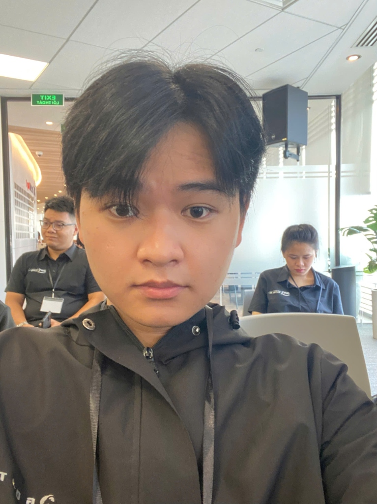

# Event Attendance Report: First Cloud AI Journey Meetup (24/10/2026)

### Event Executive Summary:
* **Event Name:** HIGH-ENERGY MEETUP: FIRST CLOUD AI JOURNEY (October 24, 2026)
* **Date & Time:** 09:00 - 12:00 AM, Saturday, October 24, 2026
* **Location:** AWS Vietnam Office, 26th Floor, Bitexco Financial Tower, No. 02 Hai Trieu, Ben Nghe Ward, District 1, Ho Chi Minh City
* **Organizers:** AWS Study Group in collaboration with First Cloud AI Journey (FCAJ) Community
* **Speakers & Guests:** Tech Leads, Solution Architects, and AWS Community Builders from leading enterprises
* **Participant Role:** Attendee / Builder

---

## 1. Objectives & Significance of the Event

The **First Cloud AI Journey** Meetup brought together seasoned cloud engineers, tech leads, and aspiring cloud developers to explore real-world production engineering, architecture blueprints, and best practices across Cloud and AI Agent ecosystems on AWS.

The core objectives of the meetup included:
1. **Bridging Academia and Enterprise Practice:** Providing deep insights into enterprise-scale engineering challenges that extend far beyond textbook theory.
2. **Exploring Cutting-Edge Technologies:** Investigating low-latency Vietnamese Voice AI, centralized multi-account governance, automated DevSecOps / IaC security auditing, and 24/7 autonomous AI Agent execution.
3. **Fostering Community Collaboration:** Providing an interactive environment for direct Q&A, knowledge sharing, and technical networking with industry leaders.

---

## 2. Technical Deep-Dive Sessions

Hosted at the AWS Vietnam Office, the morning meetup featured five intensive, high-impact technical sessions:

### 2.1. Session 1: Hear, Think, Speak – Building a Vietnamese Voice-AI Contact Center on AWS
* **Speaker:** Mr. Kiet Tran – Revve AI
* **Key Insights:**
  - **Voice AI Architecture:** Architectural blueprint integrating Speech-to-Text (STT) $\rightarrow$ Large Language Model Reasoning (LLM) $\rightarrow$ Natural Text-to-Speech (TTS) pipelines hosted on AWS cloud infrastructure.
  - **Latency Optimization:** Solving conversational friction by slashing end-to-end response latency down to **~1.8 seconds**, ensuring fluid, interruption-free natural conversations.
  - **Live Demonstration:** Real-time automated AI voice screening interview conducted in Vietnamese for a Cloud Engineer position, showcasing responsive conversational nuance and high contextual intelligence.

### 2.2. Session 2: Centralized Multi-Account Sharing with AWS Resource Access Manager (RAM)
* **Speaker:** Mr. Long Huynh – Styl Solution
* **Key Insights:**
  - **Secure Resource Sharing:** Seamlessly sharing networking and infrastructure assets (Transit Gateway, Subnets, License Manager, Route 53 Resolver Rules) across AWS accounts within AWS Organizations without duplicating resources.
  - **Cost Optimization & Network Consolidation:** Eliminating redundant provisioning while establishing centralized network governance.
  - **Defense-in-Depth Guardrails:** Combining fine-grained IAM Policies with Service Control Policies (SCPs) to enforce hard security boundaries and prevent privilege escalation across member accounts.

### 2.3. Session 3: Automated Cloud Infrastructure Pentesting with AWS Continuum & Security Agent
* **Speaker:** Mr. Thinh Nguyen – Styl Solution
* **Key Insights:**
  - **Shift-left Security:** Proactively detecting vulnerabilities during the Infrastructure as Code (IaC) design phase before deploying resources to the cloud.
  - **Automated CI/CD Verification:** Integrating Terraform static code scanners directly into GitLab/GitHub Pull Request pipelines to flag configuration drift and security anti-patterns.
  - **Autonomous Security Agent:** Deploying AI-driven agents that emulate adversarial behavior to conduct automated penetration testing across SIT/UAT environments prior to production release.

### 2.4. Session 4: Production Agent Architectures with Amazon Bedrock AgentCore
* **Speaker:** Mr. Xuan An – Leader, AWS Student Builder Group HCMUTE
* **Key Insights:**
  - **MicroVM & EC2 Spot Runtime:** Running containerized AI Agents using MicroVMs atop EC2 Spot Instances to achieve elastic scalability and dramatic compute cost reductions.
  - **Hierarchical Memory Architecture:**
    - *Short-term Memory (Synchronous):* Preserving conversational context and immediate state within active execution sessions.
    - *Long-term Memory (Asynchronous):* Asynchronously ingesting and indexing user interaction patterns to enable personalized, context-aware reasoning over time.

### 2.5. Session 5: Kiro Crew – Operating 24/7 Autonomous AI Agents for Code Review & System Auditing
* **Speakers:** Mr. Khoa Kieu – Tech Lead, ACB Bank & Mr. Nghi Danh – AWS Community Builder
* **Key Insights (Highlighted Session):**
  - **Continuous Autonomous Agents:** Running autonomous agents around the clock to assist developers with pull request reviews, logic verification, and real-time infrastructure health checks.
  - **Dynamic Artifact Generation:** Scraping real-time tech job market data and generating interactive visualization dashboards directly within conversational chat threads.
  - **Context Window Governance:**
    - *Auto Compact Mechanism:* Automatically compressing and summarizing active conversational history when token consumption hits 70% – 90% capacity.
    - *Break Down Context Tooling:* Granular token profiling across System Prompts, Message History, Tool Schemas, and Memory state.
  - **Memory Management & Strict Guardrails:**
    - Routine eviction and consolidation of stale memories to mitigate bloat and token expenditure.
    - Implementing non-negotiable security guardrails that strictly prohibit agents from triggering unauthorized resource destructions or exfiltrating server credentials.

---

## 3. Key Takeaways & Professional Growth

Participating in the First Cloud AI Journey Meetup provided immense clarity and inspiration:

1. **Enterprise Reality Check:** Concrete understanding of real-world operational challenges: conversational latency, token cost constraints, multi-account security boundaries, and strict safety guardrails.
2. **Mastery of Modern Agent Engineering:** Gained deep architectural awareness regarding tiered memory, context compaction, and automated security auditing using AI agents.
3. **Inspiration and Networking:** The dedication and openness of industry tech leads motivated me to engage more proactively, embrace continuous learning, and boldly take on hands-on challenges throughout my internship journey.

---

## 4. Attendance Verification

The photograph below verifies my physical attendance (Nguyen Trung Hau) inside the seminar hall at the AWS Vietnam Office (26th Floor, Bitexco Financial Tower) during the **First Cloud AI Journey Meetup** on October 24, 2026:

