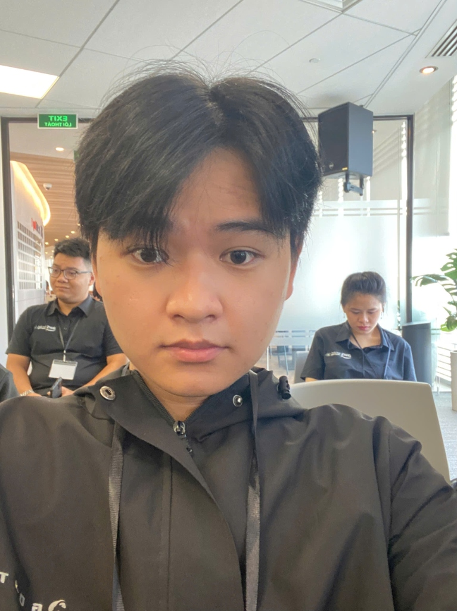

# Báo cáo tham gia sự kiện: Meetup First Cloud AI Journey (24/10/2026)

### Thông tin tổng quan sự kiện:
* **Tên sự kiện:** BUỔI MEET UP ĐẦY NĂNG LƯỢNG: FIRST CLOUD AI JOURNEY (24/10/2026)
* **Thời gian tổ chức:** 09:00 - 12:00 AM, Thứ Bảy, ngày 24/10/2026
* **Địa điểm:** Văn phòng AWS Việt Nam, Tầng 26, Tòa nhà Bitexco Financial Tower, Số 02 Hải Triều, Bến Nghé, Quận 1, TP. Hồ Chí Minh
* **Đơn vị tổ chức:** AWS Study Group phối hợp cùng Cộng đồng First Cloud AI Journey (FCAJ)
* **Khách mời & Diễn giả:** Các chuyên gia công nghệ, Tech Lead và AWS Community Builders từ các doanh nghiệp lớn
* **Vai trò tham dự:** Người tham dự (Participant / Builder)

---

## 1. Mục đích và Ý nghĩa của sự kiện

Buổi meetup **First Cloud AI Journey** là sự kiện chuyên đề công nghệ thực chiến quy tụ các kỹ sư dày dạn kinh nghiệm và các Tech Lead đầu ngành, nhằm chia sẻ những bài học thực tế trong việc triển khai giải pháp Cloud và phát triển hệ thống AI Agent trên nền tảng AWS.

Mục tiêu cốt lõi của buổi meetup bao gồm:
1. **Kết nối giữa lý thuyết và thực tiễn doanh nghiệp:** Giúp sinh viên và các kỹ sư trẻ tiếp cận những bài toán hóc búa ngoài thực tế mà môi trường học đường ít có cơ hội chạm tới.
2. **Cập nhật các đột phá công nghệ mới nhất:** Khám phá chuyên sâu từ kiến trúc Voice AI tiếng Việt, quản trị đa tài khoản (Multi-Account Architecture), bảo mật DevSecOps/Pentest tự động, đến việc vận hành AI Agent liên tục 24/7 trên môi trường Production.
3. **Thúc đẩy tinh thần học hỏi cộng đồng:** Tạo diễn đàn giao lưu cởi mở, giải đáp trực tiếp các vướng mắc kỹ thuật cùng các chuyên gia hàng đầu.

---

## 2. Chi tiết 5 phiên chia sẻ chuyên sâu (Technical Deep-Dive Sessions)

Tuy thời lượng diễn ra trong buổi sáng thứ Bảy, sự kiện đã cô đọng một khối lượng kiến thức chuyên môn đồ sộ qua 5 phiên chia sẻ chất lượng cao:

### 2.1. Session 1: Hear, Think, Speak – Xây dựng Trung tâm liên lạc Voice-AI tiếng Việt trên AWS
* **Diễn giả:** Anh Kiệt Trần – Revve AI
* **Nội dung trọng tâm:**
  - **Kiến trúc Voice AI:** Phân tích quy trình tích hợp khép kín giữa các tầng công nghệ: Nhận diện giọng nói (Speech-to-Text) $\rightarrow$ Khối suy luận ngôn ngữ lớn (LLM Reasoning) $\rightarrow$ Chuyển văn bản thành giọng nói tự nhiên (Text-to-Speech) trên nền tảng đám mây AWS.
  - **Tối ưu hóa độ trễ (Latency Optimization):** Giải quyết triệt để bài toán độ trễ phản hồi bằng cách tinh chỉnh luồng xử lý xuống chỉ còn **~1.8 giây**, tạo cảm giác đàm thoại liền mạch, tức thì và tự nhiên như người thật.
  - **Live Demo thực tế:** Trình diễn trực tiếp cuộc gọi tự động của Voice AI để phỏng vấn sơ tuyển ứng viên vị trí Cloud Engineer hoàn toàn bằng tiếng Việt với ngữ điệu sinh động và khả năng đối đáp ngữ cảnh rất mượt mà.

### 2.2. Session 2: Quản trị tài nguyên đa tài khoản với AWS Resource Access Manager (RAM)
* **Diễn giả:** Anh Long Huỳnh – Styl Solution
* **Nội dung trọng tâm:**
  - **Chia sẻ tài nguyên an toàn:** Giải pháp chia sẻ tài nguyên mạng và hạ tầng (Transit Gateway, Subnets, License Manager, Route 53 Resolver Rules) giữa các tài khoản AWS con trong cùng tổ chức AWS Organizations mà không cần sao chép hay tạo trùng lặp tài nguyên.
  - **Tối ưu chi phí & Quản trị tập trung:** Giúp doanh nghiệp tiết kiệm đáng kể ngân sách hạ tầng, đồng thời gom cụm quản lý mạng tập trung về một mối.
  - **Cơ chế phòng thủ đa lớp (Guardrails):** Kết hợp chặt chẽ giữa chính sách phân quyền IAM Policy và Service Control Policies (SCPs) để thiết lập "trần quyền hạn" tuyệt đối, đảm bảo các tài khoản thành viên không thể vượt rào an ninh.

### 2.3. Session 3: Đánh giá an ninh hạ tầng tự động với AWS Continuum & Security Agent
* **Diễn giả:** Anh Thịnh Nguyễn – Styl Solution
* **Nội dung trọng tâm:**
  - **Dịch chuyển an ninh về sớm (Shift-left Security):** Đánh giá an toàn thông tin hạ tầng đám mây ngay từ giai đoạn viết mã nguồn Infrastructure as Code (IaC).
  - **Tích hợp CI/CD tự động:** Nhúng công cụ phân tích tĩnh mã Terraform trực tiếp vào Pull Requests (GitLab/GitHub) để tự động phát hiện và cảnh báo các cấu hình sai sót (misconfigurations) trước khi hợp nhất mã nguồn.
  - **Security Agent Pentest tự động:** Sử dụng AI Agent an ninh đóng vai kẻ tấn công giả lập người dùng thực tế, tiến hành quét và dò tìm lỗ hổng tự động trên các môi trường thử nghiệm SIT/UAT trước khi đưa sản phẩm lên môi trường Production thực tế.

### 2.4. Session 4: Kiến trúc đưa Agent lên Production với Amazon Bedrock AgentCore
* **Diễn giả:** Anh Xuân An – Leader AWS Student Builder Group HCMUTE
* **Nội dung trọng tâm:**
  - **Agent Runtime trên nền MicroVM & EC2 Spot:** Kiến trúc vận hành cụm Agent trên các MicroVM kết hợp máy chủ EC2 Spot Instances, mang lại khả năng mở rộng linh hoạt với chi phí tối ưu vượt trội.
  - **Hệ thống Memory phân tầng chuyên sâu:**
    - *Short-term Memory (Bộ nhớ ngắn hạn - đồng bộ):* Duy trì thông tin ngữ cảnh trong phiên làm việc hiện tại để phản hồi chính xác tức thì.
    - *Long-term Memory (Bộ nhớ dài hạn - bất đồng bộ):* Lưu trữ tri thức và thói quen của người dùng theo thời gian một cách bất đồng bộ, giúp Agent liên tục học hỏi và thấu hiểu sâu sắc hành vi người dùng.

### 2.5. Session 5: Kiro Crew – Vận hành AI Agent 24/7 trong Review Code & Kiểm tra hệ thống
* **Diễn giả:** Anh Khoa Kiều – Tech Lead Ngân hàng ACB & Anh Nghi Danh – AWS Community Builder
* **Nội dung trọng tâm (Phiên thảo luận ấn tượng và chuyên sâu nhất):**
  - **Ứng dụng AI Agent tự hành 24/7:** Mô hình triển khai Agent chạy ngầm liên tục để tự động kiểm tra mã nguồn (Code Review), phát hiện lỗi logic và giám sát sức khỏe của toàn bộ hệ thống.
  - **Cơ chế tạo Artifacts trực quan:** Khả năng tự động cào (crawl) dữ liệu thị trường việc làm công nghệ thực tế và dựng biểu đồ thống kê trực quan tương tác ngay trong khung chat làm việc.
  - **Quản trị Cửa sổ ngữ cảnh (Context Window Management):**
    - Cơ chế **Auto Compact:** Tự động nén và tóm tắt lịch sử ngữ cảnh khi dung lượng token chạm ngưỡng 70% – 90% để tránh tràn context và tiết kiệm chi phí.
    - Tính năng **Break down Context:** Bóc tách chi tiết lượng token tiêu thụ theo từng thành phần: System Prompt, Conversation History, Tool Definitions và Memory.
  - **Quản trị Memory & Rào chắn bảo mật (Guardrails):**
    - Thiết lập cơ chế dọn dẹp các memory cũ định kỳ nhằm ngăn chặn tình trạng phình chi phí lưu trữ và suy giảm tốc độ suy luận.
    - Cấu hình lớp kiểm soát an toàn nghiêm ngặt (Strict Guardrails), ngăn chặn tuyệt đối tình trạng Agent tự ý can thiệp xóa hạ tầng hoặc làm rò rỉ thông tin bảo mật/credentials của máy chủ.

---

## 3. Kiến thức và Giá trị thu nhận được

Buổi meetup đã mang lại cho em những bước chuyển biến lớn về cả tư duy kỹ thuật lẫn định hướng phát triển nghề nghiệp:

1. **Hiểu rõ bài toán thực tế của doanh nghiệp:** Khác với các bài thực hành lý thuyết trên giảng đường, việc đưa Cloud và GenAI/Agent vào doanh nghiệp đòi hỏi giải quyết đồng thời các bài toán về: độ trễ đàm thoại, chi phí token, an toàn đa tài khoản và rào chắn an ninh nghiêm ngặt.
2. **Khai phá tiềm năng của AI Agent tự hành:** Nắm bắt được những kiến trúc tiên tiến nhất như bộ nhớ phân tầng, cơ chế Auto Compact ngữ cảnh và kiểm thử an ninh tự động bằng Agent.
3. **Mở rộng giao lưu và truyền cảm hứng:** Được lắng nghe chia sẻ từ các Tech Lead hàng đầu giúp em tự tin hơn trong việc kết nối, chủ động giao lưu, học hỏi và nỗ lực nâng cao chuyên môn để sẵn sàng cho các dự án thực tế trên nền tảng AWS.

---

## 4. Hình ảnh minh chứng tham gia sự kiện

Dưới đây là hình ảnh cá nhân của em (Nguyễn Trung Hậu) chụp trực tiếp tại khán phòng hội thảo Văn phòng AWS Việt Nam (Tầng 26 Bitexco Financial Tower) trong buổi Meetup **First Cloud AI Journey** ngày 24/10/2026:

